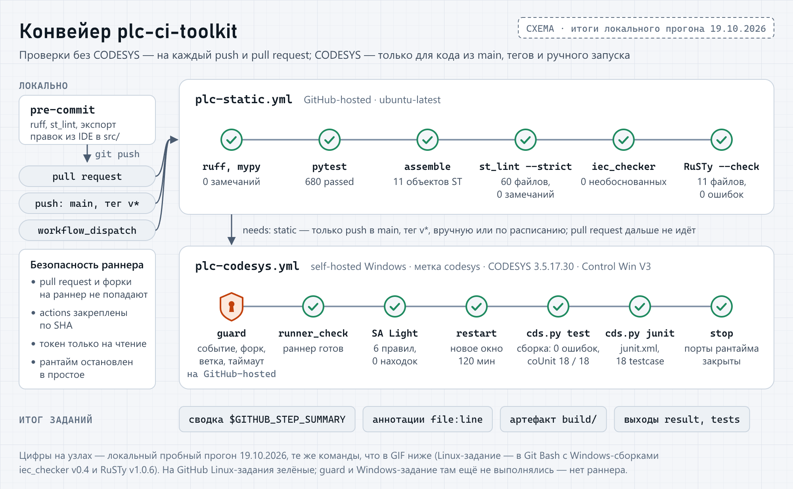
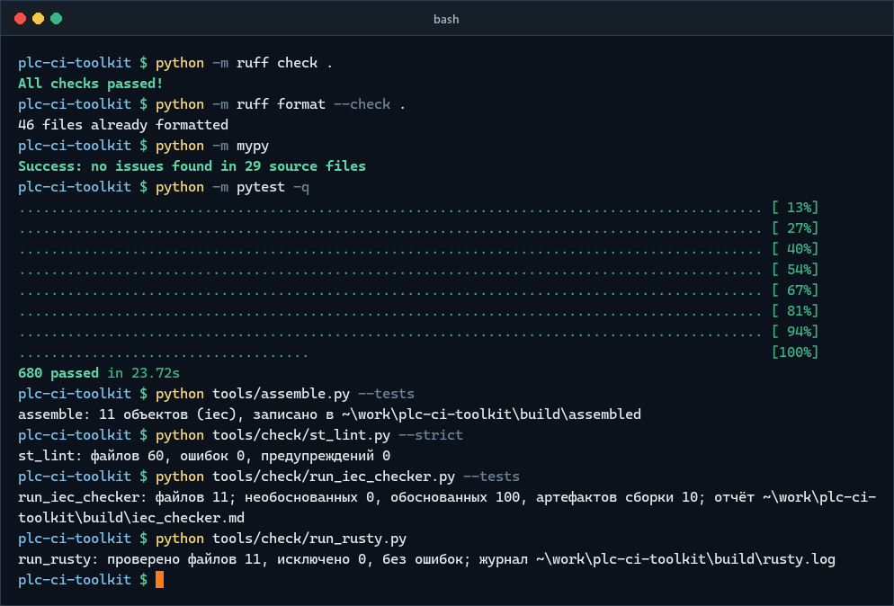
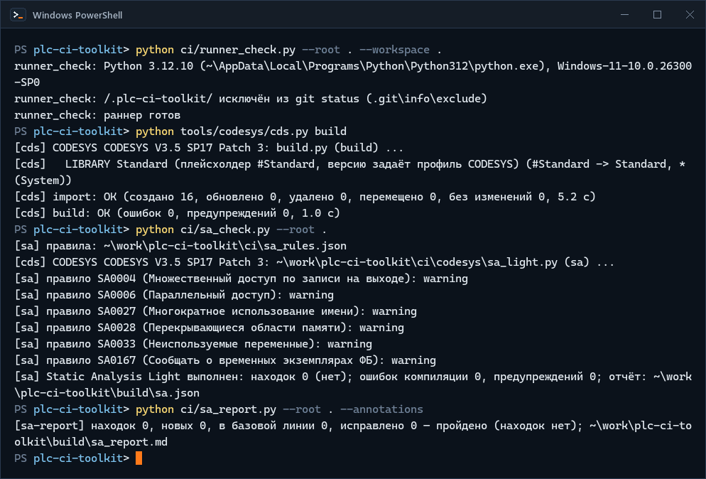
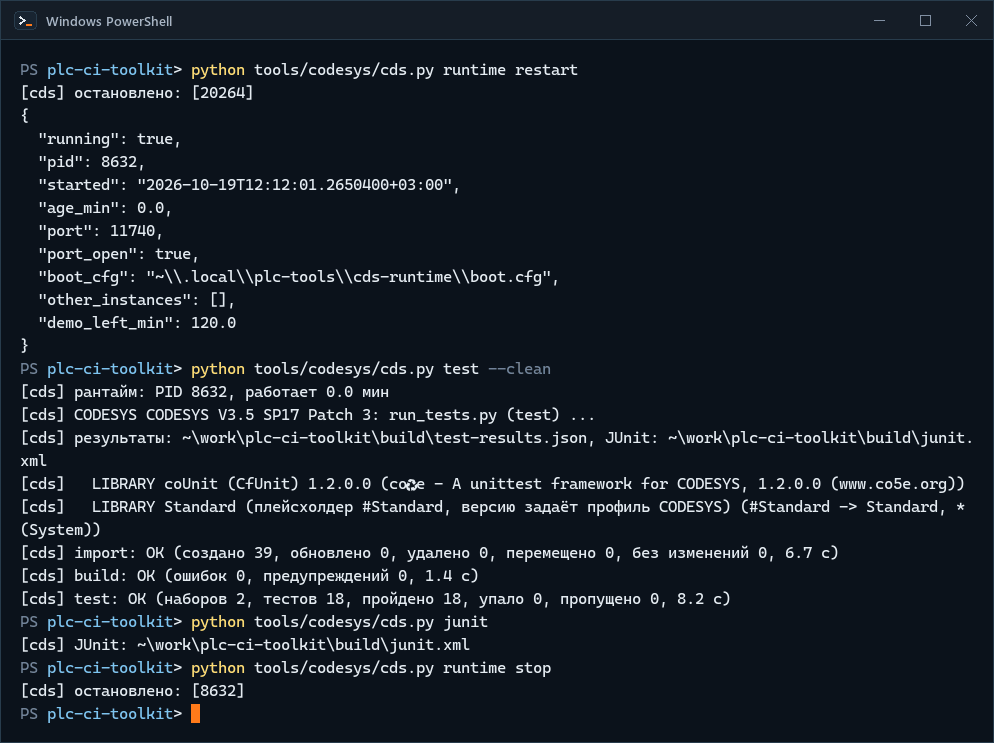
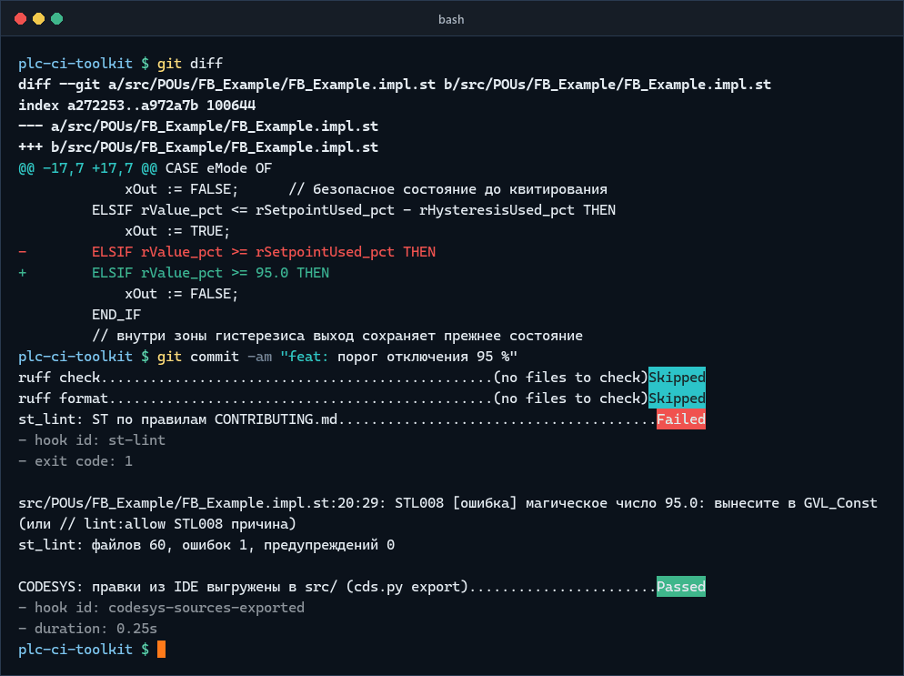
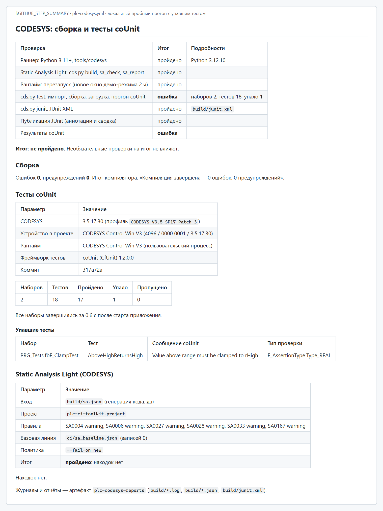

<p align="center">
  <picture>
    <source media="(prefers-color-scheme: dark)" srcset="docs/media/banner-dark.svg">
    <source media="(prefers-color-scheme: light)" srcset="docs/media/banner-light.svg">
    
  </picture>
</p>

<p align="center">
  <a href="https://github.com/kr0nsch/plc-ci-toolkit/actions/workflows/ci.yml"></a>
  <a href="docs/MANUAL_STEPS.md#12-первый-прогон-windows-job"></a>
  <a href="LICENSE"></a>
  
  
  
  
  <a href=".github/actionlint.yaml"></a>
  <a href="#тесты-и-проверки"></a>
</p>

<p align="center">
  <a href="#демонстрация">Демо</a> ·
  <a href="#архитектура">Архитектура</a> ·
  <a href="#подключение-за-10-минут">Подключение</a> ·
  <a href="#быстрый-старт-без-железа">Быстрый старт</a> ·
  <a href="docs/">Документация</a> ·
  <a href="#summary-en">Summary (EN)</a>
</p>

CI для ПЛК-кода на CODESYS V3.5: два переиспользуемых workflow GitHub Actions для репозиториев на
шаблоне [plc-repo-template](https://github.com/kr0nsch/plc-repo-template). Проверки без CODESYS —
линтеры, статанализ, проверка компиляции — идут на каждый push и pull request на GitHub-hosted
Linux; полная сборка в CODESYS 3.5.17.30, загрузка в CODESYS Control Win V3 и тесты coUnit (CfUnit)
с JUnit-отчётом — на своём Windows-раннере, только для `main`, тегов и ручного запуска. Подключение
к своему репозиторию — один файл workflow, 30 строк без комментариев.

## Демонстрация

GIF и сводка ниже сняты с реальных прогонов на этой машине (CODESYS 3.5.17.30, CODESYS Control Win V3,
coUnit 1.2.0.0): те же команды и в том же порядке, что выполняют задания на раннерах. Схема — рисунок,
цифры на ней — из этих прогонов. На GitHub Linux-задания зелёные с первого push
([прогон](https://github.com/kr0nsch/plc-ci-toolkit/actions/runs/39248625868)); Windows-задание ждёт self-hosted раннера (см. «Ограничения»).

<p align="center">
  <picture>
    <source media="(prefers-color-scheme: dark)" srcset="docs/media/diagram-pipeline-dark.png">
    <source media="(prefers-color-scheme: light)" srcset="docs/media/diagram-pipeline-light.png">
    
  </picture>
</p>
<p align="center"><sub>Схема заданий; цифры на узлах — из локального пробного прогона 19.10.2026, того же, что в GIF ниже</sub></p>

**Linux-задание `plc-static.yml`** — проверки без CODESYS, на каждый push и pull request:

<p align="center">
  
</p>
<p align="center"><sub>Реальный прогон 19.10.2026: Git Bash, Windows-сборки iec_checker v0.4 и RuSTy v1.0.6; ожидание pytest сокращено</sub></p>

**Windows-задание `plc-codesys.yml`, шаг 1** — проверка раннера и Static Analysis Light: правила
включаются скриптом на время сеанса, штатного API для этого в CODESYS 3.5.17 нет ([docs/sa_light.md](docs/sa_light.md)):

<p align="center">
  
</p>
<p align="center"><sub>Реальный прогон на CODESYS 3.5.17.30, 19.10.2026, снято term2gif</sub></p>

**Windows-задание, шаг 2** — сборка, загрузка в CODESYS Control Win V3, прогон coUnit и JUnit XML:

<p align="center">
  
</p>
<p align="center"><sub>Реальный прогон на CODESYS 3.5.17.30 и Control Win V3, 19.10.2026; результаты coUnit читаются из рантайма</sub></p>

**Красный путь** — ошибка останавливается до push: хук pre-commit запускает тот же `st_lint`, что
и CI (там замечание становится аннотацией на строке), и называет файл, строку и столбец:

<p align="center">
  
</p>
<p align="center"><sub>Реальный вывод pre-commit 4.7.0 в копии репозитория с намеренной ошибкой, 19.10.2026</sub></p>

Если до раннера всё же дошёл упавший тест, сводка задания называет набор, тест и сообщение coUnit:

<p align="center">
  <picture>
    <source media="(prefers-color-scheme: dark)" srcset="docs/media/shot-codesys-summary-dark.png">
    <source media="(prefers-color-scheme: light)" srcset="docs/media/shot-codesys-summary-light.png">
    
  </picture>
</p>
<p align="center"><sub>Вывод <code>ci/summary.py</code> из пробного прогона 16.10.2026 со сломанным тестом, отрисован локально в стиле GitHub</sub></p>

## Архитектура


- Pull request проходит только проверки без CODESYS: на машину с CODESYS попадает лишь код,
  который уже в `main`, в теге или запущен владельцем вручную.
- Оба workflow вызывают инструменты самого репозитория-потребителя (`tools/` шаблона:
  `assemble.py`, `check/`, `codesys/cds.py`), а свои скрипты `ci/` — сводку, проверку раннера,
  Static Analysis Light — берут из того же коммита plc-ci-toolkit, что и сам workflow.
- Результаты coUnit `cds.py` читает из переменных приложения в рантайме, а не из файла xUnit:
  почему — [docs/cfunit_results.md](docs/cfunit_results.md).
- Правила Static Analysis Light скрипт включает на время сеанса и запускает генерацию кода: штатного
  API для этого в CODESYS 3.5.17 нет — [docs/sa_light.md](docs/sa_light.md).

Подробно, со схемой скриптов и файлов отчётов, — [docs/ARCHITECTURE.md](docs/ARCHITECTURE.md).

## Подключение за 10 минут

Для репозитория на шаблоне plc-repo-template (`tools/`, `src/`, `tests/`, `requirements-dev.txt`).
Пошагово, с проверками и разбором ошибок, — [docs/USAGE.md](docs/USAGE.md).

1. **Локально — то же, что проверит CI**, чтобы первый запуск не был красным:

   ```bash
   python -m pip install -r requirements-dev.txt
   python -m ruff check . && python -m ruff format --check . && python -m mypy && python -m pytest -q
   python tools/check/st_lint.py --strict
   ```

2. **Вызывающий workflow** — копия [examples/consumer-ci.yml](examples/consumer-ci.yml) в
   `.github/workflows/plc-ci.yml`; обе строки `uses:` уже ссылаются на `kr0nsch/plc-ci-toolkit`
   и тег `@v1` (для своего форка — замените владельца). Главное в нём:

   ```yaml
   jobs:
     static:
       uses: kr0nsch/plc-ci-toolkit/.github/workflows/plc-static.yml@v1
     codesys:
       needs: static
       if: >-
         vars.PLC_CODESYS_RUNNER == 'true' && (github.event_name == 'workflow_dispatch' ||
         (github.event_name == 'push' && (github.ref == 'refs/heads/main' || startsWith(github.ref, 'refs/tags/v'))))
       uses: kr0nsch/plc-ci-toolkit/.github/workflows/plc-codesys.yml@v1
   ```

3. **CI шаблона** `.github/workflows/ci.yml` — удалить (`plc-ci.yml` делает те же проверки и больше)
   и перевести бейдж README на `plc-ci.yml`.
4. **Ветка и pull request** — запустится задание «Проверки без CODESYS»; задание CODESYS для PR не
   запускается никогда.
5. **Settings → Actions → General**: «Workflow permissions» — только чтение; «Approval for running
   fork pull request workflows» — **Require approval for all external contributors**.
6. **Бейдж** в README: `[](https://github.com/<владелец>/<репозиторий>/actions/workflows/plc-ci.yml)`.
7. **pre-commit** (по желанию): [examples/consumer/.pre-commit-config.yaml](examples/consumer/.pre-commit-config.yaml) —
   ruff, `st_lint` и проверка «правки из IDE выгружены в `src/`» ([docs/pre_commit.md](docs/pre_commit.md)).

Часть с CODESYS — один раз на машину, около часа (в основном установка CODESYS): раннер с меткой
`codesys` под отдельной учётной записью ([docs/runner_setup.md](docs/runner_setup.md)), регистрация
и первый ручной запуск ([docs/MANUAL_STEPS.md, разделы 9–13](docs/MANUAL_STEPS.md#9-self-hosted-раннер-порядок-действий)),
затем переменная репозитория `PLC_CODESYS_RUNNER=true`. Без неё задание CODESYS пропускается.

## Что проверяется

| Задание | Проверка | Блокирует | Отчёт |
|---|---|---|---|
| `plc-static.yml` (Linux) | ruff, ruff format, mypy, pytest для `tools/` | да | сводка, `build/pytest.xml` |
| | `assemble` → `st_lint --strict`: раскладка, заголовки POU, имена, «магические числа» | да | аннотации `file:line`, `build/st_lint.json` |
| | iec_checker v0.4 (бинарник по SHA-256) или образ nightly (по дайджесту) | да, настраивается | необоснованные находки — аннотациями, `build/iec_checker.md` |
| | RuSTy v1.0.6 `plc --check`: синтаксис и типы совместимого подмножества | нет, настраивается | аннотации, `build/rusty.log` |
| `plc-codesys.yml` (Windows) | Static Analysis Light (6 правил) с базовой линией `ci/sa_baseline.json` | новые находки | `build/sa_report.md` в сводке |
| | `cds.py test`: импорт, сборка CODESYS, загрузка, прогон coUnit | да | ошибки компилятора — аннотациями по `src/`, `build/test-results.json` |
| | `cds.py junit` → публикация JUnit (`mikepenz/action-junit-report`, только аннотации) | нет: упавший тест валит `cds.py test` | таблица тестов в сводке, `build/junit.xml` |
| pre-commit | ruff, `st_lint`, `codesys-sources-exported` | коммит | вывод хука |

Итог задания — выход `result` (`success`/`failure`) и счётчики (`tests`, `failed`, `build-errors`,
`st-lint-errors`...) для следующих заданий; все входы и выходы — [docs/USAGE.md](docs/USAGE.md),
разделы 4–5.

## Безопасность self-hosted раннера

GitHub не рекомендует self-hosted раннеры для публичных репозиториев: pull request из форка может
выполнить свой код на машине. Что сделано ([docs/runner_security.md](docs/runner_security.md)):

- **Политика запуска.** Задание CODESYS — только `push` в `main` и теги, `workflow_dispatch` и
  `schedule`; никогда `pull_request`, `pull_request_target`, `workflow_run` и не в форках. Это
  условие вызывающего workflow и задание `guard` в `plc-codesys.yml`: оно выполняется на
  GitHub-hosted раннере и отказывает до того, как задание попадёт на машину с CODESYS (разрешённые
  события перечислены явно — новое событие по умолчанию запрещено).
- **YAML не защищает от PR, который меняет сам workflow**, — поэтому обязательное одобрение запусков
  для всех внешних участников (Settings → Actions) и, по желанию, окружение с одобрением.
- **Минимальные права.** `contents: read` у заданий, `permissions: {}` у `guard`; JUnit публикуется
  аннотациями и сводкой без check run, секреты GitHub заданию не нужны.
- **Закреплённые actions.** Все `uses:` — по полному SHA коммита с комментарием версии
  (тест `ci/tests/test_workflows.py`); обновления — Dependabot с выдержкой 7 дней.
- **Машина.** Отдельная учётная запись без прав администратора, рантайм CODESYS с включённым
  управлением пользователями, рантайм останавливается в конце задания (порты закрыты в простое),
  рабочий каталог очищается; сеть раннера — без доступа к ПЛК и SCADA.

## Быстрый старт без железа

Проверить сам plc-ci-toolkit можно без CODESYS (Python 3.11+):

```bash
python -m pip install -r requirements-dev.txt
python -m pytest                     # скрипты ci/ и инструменты шаблона
python -m ruff check . && python -m ruff format --check . && python -m mypy
python -m pre_commit run --all-files # ruff, st_lint, «исходники выгружены»
actionlint                           # workflow; настройки — .github/actionlint.yaml
```

Шаги Linux-задания на собственном примере ST — те же команды, что в `plc-static.yml`:

```bash
python tools/assemble.py --tests
python tools/check/st_lint.py --strict
python tools/check/run_iec_checker.py --binary <путь к iec_checker v0.4> --tests
python tools/check/run_rusty.py --plc <путь к plc> --stdlib <stdlib/include>
```

С CODESYS 3.5.17.30 на Windows — шаги Windows-задания по порядку (как на демонстрации выше):

```bash
python tools/codesys/cds.py build
python ci/sa_check.py --root .
python ci/sa_report.py --root .
python tools/codesys/cds.py runtime restart
python tools/codesys/cds.py test --clean
python tools/codesys/cds.py junit
python tools/codesys/cds.py runtime stop
```

Пример ST в `src/` и `tests/` (насос подкачки и 18 тестов coUnit) — из шаблона, без изменений: это
тестовый стенд, на котором CI проверяет сами workflow. Команды `cds.py` и раскладка —
[tools/README.md](tools/README.md), [docs/LAYOUT.md](docs/LAYOUT.md).

## Тесты и проверки

| Проверка | Где | Что |
|---|---|---|
| actionlint 1.7.12 | CI (`ci.yml`) | четыре workflow и пример `examples/consumer-ci.yml` (входы сверяются с переиспользуемыми workflow) |
| pytest `ci/tests` | CI: Linux (Python 3.11, 3.13), Windows (3.11) | сводка, проверка раннера, Static Analysis Light, хук pre-commit, правила безопасности workflow |
| `plc-static.yml` на собственном примере | CI (`ci.yml`), локальный вызов `./.github/workflows/` | тот же вызов, что у потребителя; отдельно — с образом iec_checker nightly (не блокирует) |
| `plc-codesys.yml` на собственном примере | workflow `codesys.yml`, self-hosted Windows | включается переменной `PLC_CODESYS_RUNNER` |

**Пробный прогон 16.10.2026 на этой машине.** Шаги обоих workflow выполнены локально в том же
порядке и с теми же условиями `if:`, на собственном примере ST:

- Linux-задание — в Git Bash, с Windows-сборками iec_checker v0.4 и RuSTy v1.0.6 вместо загрузки
  Linux-бинарников: все 17 шагов зелёные, pytest — 463 теста, `st_lint` — 0 замечаний,
  iec_checker — 0 необоснованных находок, RuSTy — 0 ошибок. С внесённым «магическим числом»
  задание падает, сводка и аннотация указывают на файл и строку.
- Windows-задание — в той же обёртке Windows PowerShell 5.1, что у раннера, с CODESYS 3.5.17.30 и
  Control Win V3: Static Analysis Light — 0 находок, рантайм перезапущен (окно 120 мин),
  18 из 18 тестов coUnit, JUnit, `result=success`. Со сломанным тестом задание падает, JUnit и
  сводка называют тест и сообщение coUnit; с ошибкой компиляции — аннотация на строке в `src/`;
  без CODESYS шаг падает с кодом 3, и этот код виден в журнале шага.
- Подключение к чистому репозиторию из шаблона по [docs/USAGE.md](docs/USAGE.md) (копия
  `examples/consumer-ci.yml`, CI шаблона удалён): оба задания зелёные — 311 тестов pytest шаблона,
  0 находок Static Analysis Light (правила — по умолчанию из plc-ci-toolkit, базовой линии нет),
  18 из 18 тестов coUnit; Windows-задание — и в каталоге с пробелами и скобками в пути.

**Повторный прогон 19.10.2026** — после синхронизации инструментов с шаблоном, медиа в
«Демонстрации»: Linux-задание — pytest 680 тестов, `st_lint` 0 замечаний, iec_checker 0 необоснованных
находок, RuSTy 0 ошибок; Windows-задание — Static Analysis Light 0 находок, сборка без ошибок, 18 из 18
тестов coUnit, JUnit XML; pre-commit останавливает коммит с «магическим числом».

На GitHub (19.10.2026) зелёные actionlint, `plc-static.yml` на примере ST и скрипты `ci/` на Ubuntu и
Windows ([прогон](https://github.com/kr0nsch/plc-ci-toolkit/actions/runs/39248625868)); задание CODESYS без раннера пропускается (см. «Ограничения»).

## Документация

- [USAGE.md](docs/USAGE.md) — подключение, входы и выходы workflow, политика запуска, версии, бейджи
- [runner_setup.md](docs/runner_setup.md) — Windows-раннер с CODESYS: учётная запись, рантайм, служба, демо-режим 2 ч
- [runner_security.md](docs/runner_security.md) — риски self-hosted раннера, меры, чек-лист
- [MANUAL_STEPS.md](docs/MANUAL_STEPS.md) — регистрация раннера и первый прогон (разделы 9–14), выпуск (раздел 17)
- [ARCHITECTURE.md](docs/ARCHITECTURE.md) — как устроены workflow и скрипты `ci/`
- [cfunit_results.md](docs/cfunit_results.md) — как coUnit отдаёт результаты; обёртка `GVL_TestResults` в [examples/st/](examples/st/)
- [sa_light.md](docs/sa_light.md) — Static Analysis Light скриптом, отчёт и базовая линия
- [pre_commit.md](docs/pre_commit.md) — хуки pre-commit
- [ASSUMPTIONS.md](docs/ASSUMPTIONS.md) — допущения и решения (разделы E, W, S — про CI)
- [STATIC_ANALYSIS.md](docs/STATIC_ANALYSIS.md), [TEST_REPORT.md](docs/TEST_REPORT.md) — отчёты по примеру ST
- [CHANGELOG.md](CHANGELOG.md), [CONTRIBUTING.md](CONTRIBUTING.md)

## Ограничения и дальнейшие шаги

- **Windows-задание на раннере ещё не проходило.** Критерий «сборка, тесты, JUnit в отчёте на раннере
  владельца» подтверждает владелец по [MANUAL_STEPS.md, разделы 9–13](docs/MANUAL_STEPS.md#9-self-hosted-раннер-порядок-действий);
  до этого бейдж CODESYS статичный.
- **Очередь Windows-заданий не проверена.** Первый запуск на GitHub подтвердил выгрузку скриптов `ci/`
  через `job.workflow_repository` и `job.workflow_sha` ([прогон](https://github.com/kr0nsch/plc-ci-toolkit/actions/runs/39248625868)); `plc-codesys.yml` с
  `concurrency.queue: max` GitHub принял (задание пропущено, а не «Invalid workflow file»), но саму очередь
  покажут только запуски на раннере ([ASSUMPTIONS.md, W3–W4](docs/ASSUMPTIONS.md#переиспользуемые-workflow-plc-ci-toolkit)).
  actionlint 1.7.12 эти ключи не знает (отфильтровано в `.github/actionlint.yaml`); в CI задание actionlint
  проверяет скрипты и shellcheck.
- **Нужен свой раннер.** У GitHub нет раннеров с CODESYS. Рантайм без лицензии работает 2 ч —
  задание перезапускает его и не может длиться дольше 110 мин; рантайм один на машину, поэтому
  задания идут по очереди.
- **Static Analysis Light** включается через внутренние имена CODESYS 3.5.17.30: в другой версии
  скрипт откажет с кодом 3, тогда — ручной шаг ([MANUAL_STEPS.md, раздел 16](docs/MANUAL_STEPS.md#16-static-analysis-light-правила-в-ide)).
  Правила платной версии Static Analysis недоступны.
- **Раннер как служба Windows** с рантаймом в пользовательском процессе ещё не проверен
  (ASSUMPTIONS.md, E8–E9); проверенный режим — интерактивный `run.cmd`.
- iec_checker и RuSTy понимают не все расширения CODESYS; coUnit 1.2.0.0 не развивается с 2022 года.

## Summary (EN)

CI toolkit for CODESYS V3.5 (3.5.17.30) PLC repositories built from the plc-repo-template. Reusable
workflow `plc-static.yml` runs ruff, mypy, pytest, ST assembly, the `st_lint` linter, iec_checker and
an optional RuSTy check on GitHub-hosted Linux; `plc-codesys.yml` runs on a self-hosted Windows runner:
Static Analysis Light with a baseline, import, build, download to CODESYS Control Win V3, coUnit tests
read from runtime variables, JUnit published as annotations and a job summary with read-only tokens.
The Windows job never runs on pull requests (a guard job enforces it); all actions are pinned by SHA.
A pre-commit hook blocks commits with IDE edits not exported to `src/`. All steps were dry-run locally
with real CODESYS; on GitHub the Linux jobs are green, the Windows job awaits a self-hosted runner.
Docs are in Russian.

## Лицензия

[MIT](LICENSE) © 2026 kr0nsch

---

<p align="center"><b>Портфолио АСУ ТП</b></p>
<table>
<tr><td width="33%"><a href="https://github.com/kr0nsch/plc-repo-template">01 · plc-repo-template</a><br><sub>ST в git, сборка проекта скриптом, CI</sub></td><td width="33%"><a href="https://github.com/kr0nsch/plc-process-lib">02 · plc-process-lib</a><br><sub>ФБ: AI, двигатель, ПЧ, задвижка, ПИД, тревоги</sub></td><td width="33%"><span data-repo="kns-pump-station">03 · kns-pump-station</span> <sub>(готовится)</sub><br><sub>флагман: КНС, три насоса с ПЧ, модель, HMI</sub></td></tr>
<tr><td width="33%"><span data-repo="kns-port-domestic">04 · kns-port-domestic</span> <sub>(готовится)</sub><br><sub>перенос на Astra.IDE / MasterSCADA 4D</sub></td><td width="33%"><span data-repo="plc-iiot-stack">05 · plc-iiot-stack</span> <sub>(готовится)</sub><br><sub>OPC UA / MQTT → InfluxDB → Grafana</sub></td><td width="33%"><span data-repo="iolistgen">06 · iolistgen</span> <sub>(готовится)</sub><br><sub>перечень сигналов → ST, карты Modbus, SCADA</sub></td></tr>
<tr><td width="33%"><a href="https://github.com/kr0nsch/plc-ci-toolkit"><b>07 · plc-ci-toolkit</b></a><br><sub>линтеры, сборка CODESYS, тесты, JUnit</sub></td><td width="33%"><a href="https://github.com/kr0nsch/s7-to-codesys">08 · s7-to-codesys</a><br><sub>конвертер SCL → ST с отчётом о переносе</sub></td><td width="33%"><a href="https://github.com/kr0nsch/sis-interlock-demo">09 · sis-interlock-demo</a><br><sub>ПАЗ: MooN, матрица причин и следствий</sub></td></tr>
</table>
