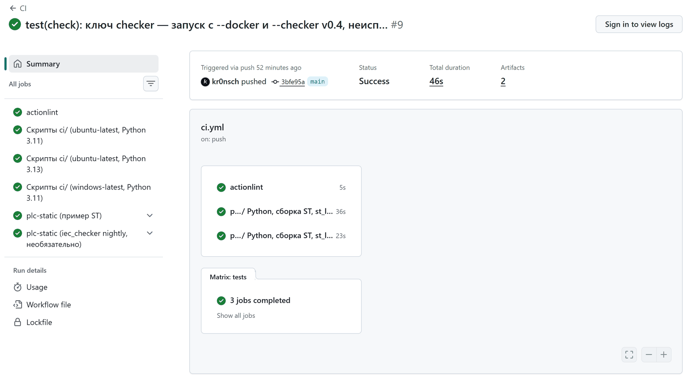
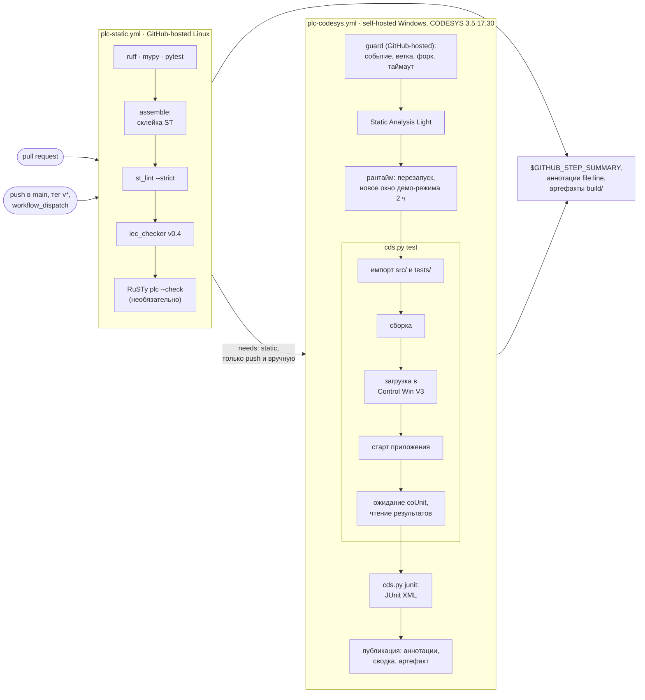

<p align="center">
  <picture>
    <source media="(prefers-color-scheme: dark)" srcset="docs/media/banner-dark.svg">
    <source media="(prefers-color-scheme: light)" srcset="docs/media/banner-light.svg">
    
  </picture>
</p>

<p align="center">
  <a href="https://github.com/kr0nsch/plc-ci-toolkit/actions/workflows/ci.yml"></a>
  <a href="https://github.com/kr0nsch/plc-ci-toolkit/releases/latest"></a>
  <a href="docs/MANUAL_STEPS.md#12-первый-прогон-windows-job"></a>
  
  <a href="LICENSE"></a>
</p>

<p align="center">
  <a href="#что-это-и-зачем">Что это</a> ·
  <a href="#как-это-выглядит">Как выглядит</a> ·
  <a href="#быстрый-старт">Быстрый старт</a> ·
  <a href="#как-использовать-в-своём-проекте">Подключение</a> ·
  <a href="#как-устроено">Как устроено</a> ·
  <a href="#документация">Документация</a> ·
  <a href="#summary-en">Summary (EN)</a>
</p>

**CI для ПЛК-проектов на CODESYS V3.5 в GitHub.** Проект CODESYS — бинарный файл `.project`: в git
не видно, что изменилось, pull request не отревьюить, а сборку и юнит-тесты запускают вручную в IDE.
Текст для git даёт шаблон [plc-repo-template](https://github.com/kr0nsch/plc-repo-template):
исходники ST в `src/` и `tests/`, куда проект один раз выгружается командой `cds.py export` из
`tools/` шаблона. plc-ci-toolkit — CI для репозиториев на этом шаблоне и с его `tools/`: каждый pull request —
линтер и статанализ примерно за минуту без CODESYS, каждый push в `main` — сборка в настоящем
CODESYS и юнит-тесты на вашем Windows-раннере. Для команд АСУ ТП, которые ведут проекты CODESYS в git.

## Что это и зачем

Два переиспользуемых workflow GitHub Actions — ваш репозиторий вызывает их строкой `uses:` — и
хук pre-commit:

| Компонент | Где выполняется | Когда | Что делает |
|---|---|---|---|
| [`plc-static.yml`](.github/workflows/plc-static.yml) | GitHub-hosted Linux, ставить ничего не нужно | каждый push и pull request | ruff, mypy, pytest для Python-инструментов; линтер ST `st_lint`; статанализ iec_checker; проверка компиляции RuSTy |
| [`plc-codesys.yml`](.github/workflows/plc-codesys.yml) | ваш self-hosted Windows с CODESYS 3.5.17.30 | push в `main`, теги `v*`, ручной запуск; никогда — pull request | Static Analysis Light; импорт `src/` и `tests/` в проект, сборка, загрузка в CODESYS Control Win V3, тесты coUnit, отчёт JUnit XML |
| хук [`codesys-sources-exported`](.pre-commit-hooks.yaml) | компьютер инженера | `git commit` | останавливает коммит, если правки из IDE не выгружены в `src/` или в коммит попал `.project` |

**Что даёт:**

- Замечания — аннотациями на строках pull request примерно через минуту, без CODESYS и лицензий:
  раскладка и имена по правилам, «магические числа», синтаксис и типы, находки статанализа.
- Сборка и тесты coUnit в настоящем CODESYS после каждого слияния в `main` — без ручного запуска
  IDE; итог — сводка на странице запуска, аннотации упавших тестов, JUnit XML в артефакте.
- Static Analysis Light (6 правил, бесплатная часть статанализа CODESYS) в CI. Штатно из скрипта
  в CODESYS 3.5.17 его не включить — тулкит делает это сам ([docs/sa_light.md](docs/sa_light.md)).
- Self-hosted раннер, безопасный для публичного репозитория: pull request и форки на машину с
  CODESYS не попадают — это проверяют условие workflow и отдельное задание `guard`.
- Подключение — один файл [examples/consumer-ci.yml](examples/consumer-ci.yml), 32 строки без
  комментариев; версия закреплена тегом `@v1`, все actions внутри — по SHA коммита.

**Для кого.** Инженеры АСУ ТП и техлиды у интеграторов, машиностроителей и вендоров ПЛК, которые
держат код CODESYS в git на GitHub и хотят ревью и автоматические проверки, как в разработке ПО.

**Что нужно от репозитория.** Исходники — текстом ST в раскладке шаблона
[plc-repo-template](https://github.com/kr0nsch/plc-repo-template) (`src/`, `tests/`), рядом — его
инструменты `tools/`: workflow вызывают именно их, сам тулкит `.project` в текст не переводит.
Проект пока только в `.project` — его выгружают в раскладку командой `cds.py export` шаблона
([как](#если-проект-ещё-не-на-шаблоне)).

<details>
<summary>Термины: coUnit, JUnit XML, st_lint, iec_checker, RuSTy, Control Win V3, self-hosted раннер</summary>

| Термин | Что это |
|---|---|
| coUnit (CfUnit) | фреймворк юнит-тестов для CODESYS (MIT, порт TcUnit); здесь — версия 1.2.0.0 |
| JUnit XML | стандартный формат отчёта о тестах; его читают Jenkins, GitLab CI и actions GitHub |
| `st_lint` | линтер ST из plc-repo-template: раскладка, заголовки POU, префиксы имён, «магические числа» ([правила](tools/README.md#checkst_lintpy--линтер)) |
| iec_checker | открытый статанализатор IEC 61131-3 ([iec-checker](https://github.com/iec-checker/iec-checker)), версия v0.4 |
| RuSTy | открытый компилятор ST ([PLC-lang/rusty](https://github.com/PLC-lang/rusty)), v1.0.6; здесь — только проверка синтаксиса и типов `plc --check` |
| Static Analysis Light | бесплатная часть статанализа CODESYS: 6 правил (неиспользуемые переменные, параллельная запись из разных задач и др.) |
| CODESYS Control Win V3 | программный ПЛК CODESYS для Windows; без лицензии работает 2 ч |
| self-hosted раннер | своя машина, на которой GitHub Actions выполняет задания; раннеров с CODESYS у GitHub нет |

</details>

## Как это выглядит

Записи сделаны на машине автора (Windows 11, CODESYS 3.5.17.30 — 32-битная сборка ОВЕН, CODESYS
Control Win V3, coUnit 1.2.0.0) теми же командами и в том же порядке, что выполняют задания на
раннерах; скриншот GitHub — прогон CI этого репозитория.

<p align="center">
  <picture>
    <source media="(prefers-color-scheme: dark)" srcset="docs/media/diagram-pipeline-dark.png">
    <source media="(prefers-color-scheme: light)" srcset="docs/media/diagram-pipeline-light.png">
    
  </picture>
</p>
<p align="center"><sub>Что где запускается. Цифры — из локального прогона 19.10.2026, того же, что в GIF ниже (тогда — 680 тестов pytest, сейчас — 686)</sub></p>

**Pull request — проверки без CODESYS.** Шаги `plc-static.yml`: ruff и mypy, pytest, сборка ST,
`st_lint`, iec_checker, RuSTy — все без замечаний:

<p align="center">
  
</p>
<p align="center"><sub>Git Bash, Windows-сборки iec_checker v0.4 и RuSTy v1.0.6, 19.10.2026; ожидание pytest сокращено</sub></p>

**Тот же workflow на GitHub.** CI этого репозитория вызывает `plc-static.yml` на собственном
примере ST — задание прошло за 36 с:

<p align="center">
  <picture>
    <source media="(prefers-color-scheme: dark)" srcset="docs/media/shot-github-ci-dark.png">
    <source media="(prefers-color-scheme: light)" srcset="docs/media/shot-github-ci-light.png">
    
  </picture>
</p>
<p align="center"><sub>Скриншот <a href="https://github.com/kr0nsch/plc-ci-toolkit/actions/runs/39259547098">прогона 19.10.2026</a> (страница без входа в GitHub)</sub></p>

**Ошибка останавливается до push.** Хук pre-commit запускает тот же `st_lint`, что и CI, и называет
файл, строку и столбец:

<p align="center">
  
</p>
<p align="center"><sub>Реальный вывод pre-commit 4.7.0 в копии репозитория с намеренной ошибкой, 19.10.2026</sub></p>

**После слияния — CODESYS на раннере.** Перезапуск рантайма, импорт, сборка, загрузка в
Control Win V3, 18 из 18 тестов coUnit, JUnit XML:

<p align="center">
  
</p>
<p align="center"><sub>Реальный прогон на CODESYS 3.5.17.30 и Control Win V3, 19.10.2026; результаты coUnit читаются из рантайма</sub></p>

<details>
<summary>Ещё: Static Analysis Light и сводка задания с упавшим тестом</summary>

Первый шаг Windows-задания — проверка раннера и Static Analysis Light: правила включаются
скриптом на время сеанса ([docs/sa_light.md](docs/sa_light.md)):

<p align="center">
  
</p>
<p align="center"><sub>Реальный прогон на CODESYS 3.5.17.30, 19.10.2026, снято term2gif</sub></p>

Если до раннера дошёл упавший тест, сводка задания называет набор, тест и сообщение coUnit:

<p align="center">
  <picture>
    <source media="(prefers-color-scheme: dark)" srcset="docs/media/shot-codesys-summary-dark.png">
    <source media="(prefers-color-scheme: light)" srcset="docs/media/shot-codesys-summary-light.png">
    
  </picture>
</p>
<p align="center"><sub>Вывод <code>ci/summary.py</code> из пробного прогона 16.10.2026 со сломанным тестом, отрисован локально в стиле GitHub</sub></p>

</details>

## Быстрый старт

### В своём репозитории на GitHub

Нужно: репозиторий на GitHub в раскладке plc-repo-template (создан кнопкой **Use this template**
или [переведён](#если-проект-ещё-не-на-шаблоне)) и git. CODESYS не нужен.

1. Добавьте вызывающий workflow и уберите CI шаблона — он делает те же проверки, иначе они пойдут
   дважды (из корня репозитория, Git Bash или Linux):

   ```bash
   mkdir -p .github/workflows
   curl -fsSL https://raw.githubusercontent.com/kr0nsch/plc-ci-toolkit/v1/examples/consumer-ci.yml \
     -o .github/workflows/plc-ci.yml
   git rm .github/workflows/ci.yml
   ```

   В PowerShell — `Invoke-WebRequest <тот же URL> -OutFile .github/workflows/plc-ci.yml`.

2. Отправьте в ветку и откройте pull request:

   ```bash
   git switch -c ci/plc-ci-toolkit
   git add .github/workflows/plc-ci.yml
   git commit -m "ci: проверки plc-ci-toolkit"
   git push -u origin ci/plc-ci-toolkit
   ```

3. Увидите в pull request workflow **PLC CI**: проверка «Проверки без CODESYS» — около минуты;
   на странице запуска (Summary) — таблица проверок и находки с файлом и строкой, сами замечания —
   аннотациями в диффе. Задание «CODESYS — сборка и тесты coUnit» в pull request пропускается — так
   задумано.

Дальше — настройки репозитория, бейдж, pre-commit и раннер с CODESYS:
[Как использовать в своём проекте](#как-использовать-в-своём-проекте).

### Локально, без GitHub и без CODESYS

Те же шаги, что у Linux-задания, на примере ST этого репозитория. Нужны Python 3.11+ и git
(Windows, Linux или macOS):

```bash
git clone https://github.com/kr0nsch/plc-ci-toolkit.git
cd plc-ci-toolkit
python -m pip install -r requirements-dev.txt
python -m pytest -q
python tools/assemble.py --tests
python tools/check/st_lint.py --strict
```

| Команда | Увидите |
|---|---|
| `pytest -q` | `676 passed, 10 skipped`: 10 интеграционных тестов ждут iec_checker и RuSTy; с ними — `686 passed` |
| `assemble.py --tests` | `assemble: 11 объектов (iec), записано в …/build/assembled` |
| `st_lint.py --strict` | `st_lint: файлов 60, ошибок 0, предупреждений 0` |

Статанализ и проверка компиляции — необязательно: скачайте
[iec_checker v0.4](https://github.com/iec-checker/iec-checker/releases/tag/v0.4) и
[RuSTy v1.0.6](https://github.com/PLC-lang/rusty/releases/tag/v1.0.6) (бинарник `plc` и `stdlib`):

```bash
python tools/check/run_iec_checker.py --binary <путь к iec_checker> --tests
python tools/check/run_rusty.py --plc <путь к plc> --stdlib <каталог stdlib/include>
```

Увидите: `run_iec_checker (v0.4): файлов 11; необоснованных 0, обоснованных 100…` и
`run_rusty: проверено файлов 11, исключено 0, без ошибок`. Ключи можно не указывать, если положить
инструменты в `~/.local/plc-tools/iec-checker/` и `~/.local/plc-tools/rusty/` или задать переменные
`IEC_CHECKER` и `RUSTY_PLC` ([tools/README.md](tools/README.md#checkrun_iec_checkerpy--статанализ)).

<details>
<summary>С CODESYS 3.5.17.30 на Windows: шаги Windows-задания</summary>

Нужны CODESYS 3.5.17.30 с CODESYS Control Win V3 и coUnit 1.2.0.0
([MANUAL_STEPS.md, разделы 1–4](docs/MANUAL_STEPS.md#1-установка-codesys-351730)). Те же команды
CODESYS и в том же порядке, что у задания `plc-codesys.yml` (cmd или PowerShell); его служебные
шаги для GitHub — проверка раннера (`ci/runner_check.py`) и сводка (`ci/summary.py`) — здесь опущены:

```bat
python tools\codesys\cds.py build
python ci\sa_check.py --root .
python ci\sa_report.py --root .
python tools\codesys\cds.py runtime restart
python tools\codesys\cds.py test --clean
python tools\codesys\cds.py junit
python tools\codesys\cds.py runtime stop
```

Увидите: сборка без ошибок, Static Analysis Light — 0 находок, 18 из 18 тестов coUnit,
`build\junit.xml` (как в GIF выше). Все команды `cds.py` — [tools/README.md](tools/README.md#codesyscdspy--codesys-из-консоли).

</details>

## Как использовать в своём проекте

Как это выглядит в работе: инженер правит ST в `src/` (или в IDE — [Работа в IDE](#работа-в-ide)),
хук pre-commit проверяет коммит, pull request проходит проверки без CODESYS, а после слияния код в
`main` собирается и тестируется в CODESYS на раннере. Полная справка — [docs/USAGE.md](docs/USAGE.md).

### Что нужно в репозитории

- Раскладка ST: `src/` и `tests/` ([docs/LAYOUT.md](docs/LAYOUT.md)) — текст, а не `.project`.
- `tools/` из plc-repo-template 1.0.0 или новее: workflow вызывают `tools/assemble.py`,
  `tools/check/st_lint.py`, `run_iec_checker.py`, `run_rusty.py` и `tools/codesys/cds.py` вашего
  репозитория. В этом репозитории `tools/` — копия шаблона, на ней CI и проверяет workflow.
- `pyproject.toml` и `requirements-dev.txt` — для проверок Python (отключаются входом
  `python-checks: false`).

### Если проект ещё не на шаблоне

1. На GitHub: [plc-repo-template](https://github.com/kr0nsch/plc-repo-template) → **Use this
   template** → новый репозиторий; клонируйте его.
2. Скопируйте свой проект в `build\<имя каталога репозитория>.project` и выполните
   `python tools\codesys\cds.py export`: POU, DUT, GVL и интерфейсы на ST выгрузятся в `src/`
   вместо примера шаблона. Тесты примера в `tests/` удалите или замените своими.
3. Задачи и библиотеки проекта перенесите в `tools/codesys/config.json`, затем
   `python tools\codesys\cds.py import --clean` и `python tools\codesys\cds.py build`: проект
   пересоздаётся из текста — с устройством CODESYS Control Win V3, на котором CI собирает и
   тестирует код.
4. `python tools/check/st_lint.py --strict`. Правила линтера, которые код пока не выполняет, —
   уровнем `off` в разделе `[severity]` файла `tools/check/st_lint.toml` (`warning` не поможет:
   с `--strict`, как в CI и pre-commit, предупреждения тоже дают код 1), отдельные места —
   подавлением `// lint:allow STL008 причина`.

Команды `cds.py` — на Windows с CODESYS 3.5.17.30. Перенос готового проекта целиком не
проверялся: `export`, `import --clean` и `build` проверены в CODESYS только на примере шаблона. Что
не выгружается в текст (графические языки, действия, визуализации, дерево устройств) и
подробности — [docs/USAGE.md, раздел 9](docs/USAGE.md#9-если-проект-ещё-не-на-шаблоне).

### Работа в IDE

`.project` в git нет: его собирают из текста, правят в IDE и перед коммитом выгружают обратно
(Windows, CODESYS 3.5.17.30):

```bat
python tools\codesys\cds.py import
rem открыть build\<имя каталога репозитория>.project в CODESYS, править, сохранить, закрыть IDE
python tools\codesys\cds.py export
git add src
git commit -m "fix: ..."
```

Проект с тестами — `import --tests` и `export --tests` (`build\<имя>-tests.project`). Пока проект
открыт в IDE, `cds.py` с ним не работает; `import` не перезапишет правки, сохранённые в IDE и не
выгруженные. Задачи и библиотеки правят в `tools/codesys/config.json`, а не в IDE. Если проект
сохранён в IDE, а `export` забыт, коммит остановит [хук pre-commit](#хук-pre-commit). Подробно —
[MANUAL_STEPS.md, раздел 6](docs/MANUAL_STEPS.md#6-работа-в-ide-и-экспорт-перед-коммитом).

### Порядок подключения

1. Локально — то же, что проверит CI, чтобы первый запуск не был красным:

   ```bash
   python -m pip install -r requirements-dev.txt
   python -m ruff check . && python -m ruff format --check . && python -m mypy && python -m pytest -q
   python tools/check/st_lint.py --strict
   ```

2. [Вызывающий workflow](#вызывающий-workflow) и pull request — шаги 1–3
   [быстрого старта](#в-своём-репозитории-на-github). Бейдж CI шаблона в README переведите на
   `plc-ci.yml`.
3. **Settings → Actions → General**, один раз: «Workflow permissions» — **Read repository contents
   and packages permissions**; «Approval for running fork pull request workflows from contributors» —
   **Require approval for all external contributors**; если включён список разрешённых actions —
   добавьте `mikepenz/action-junit-report@*` (и workflow plc-ci-toolkit, если ваш репозиторий у
   другого владельца, — [USAGE.md, раздел 1](docs/USAGE.md#1-за-10-минут-проверки-без-codesys)).
4. Бейдж в README (подставьте владельца и репозиторий):

   ```markdown
   [](https://github.com/<владелец>/<репозиторий>/actions/workflows/plc-ci.yml)
   ```

5. По желанию — [хук pre-commit](#хук-pre-commit); для сборки и тестов в CODESYS —
   [раннер](#раннер-с-codesys).

### Вызывающий workflow

Файл `.github/workflows/plc-ci.yml` — копия [examples/consumer-ci.yml](examples/consumer-ci.yml).
Здесь он целиком, без строк комментариев:

```yaml
name: PLC CI

on:
  push:
    branches: [main]
    tags: ["v*"]
  pull_request:
  workflow_dispatch:

permissions:
  contents: read

concurrency:
  group: plc-ci-${{ github.event_name == 'pull_request' && github.ref || github.run_id }}
  cancel-in-progress: ${{ github.event_name == 'pull_request' }}

jobs:
  static:
    name: Проверки без CODESYS
    uses: kr0nsch/plc-ci-toolkit/.github/workflows/plc-static.yml@v1
    with:
      iec-checker: binary # binary (v0.4) | docker (nightly) | off
      rusty: true

  codesys:
    name: CODESYS — сборка и тесты coUnit
    needs: static
    if: >-
      vars.PLC_CODESYS_RUNNER == 'true' && (
        github.event_name == 'workflow_dispatch' ||
        (github.event_name == 'push' &&
          (github.ref == 'refs/heads/main' || startsWith(github.ref, 'refs/tags/v')))
      )
    uses: kr0nsch/plc-ci-toolkit/.github/workflows/plc-codesys.yml@v1
    with:
      restart-runtime: true # новое окно демо-режима 2 ч перед каждым прогоном
      sa-fail-on: new # находки Static Analysis Light вне ci/sa_baseline.json валят задание
```

- `static` идёт на каждый push в `main` и каждый pull request.
- `codesys` — только push в `main`, теги `v*` и ручной запуск, и только когда задана переменная
  репозитория `PLC_CODESYS_RUNNER=true` (раннер подключён).
- Pull request: новый push отменяет прошлый запуск; у push в `main` группа своя — ожидающий прогон
  в CODESYS не отменяется.
- Токену хватает `contents: read`; секреты не нужны — `secrets: inherit` не пишите.

### Входы workflow

Чаще всего меняют эти входы; все входы и выходы обоих workflow — [USAGE.md, разделы 4–5](docs/USAGE.md#4-plc-staticyml-входы-и-выходы).

| Вход | Workflow | По умолчанию | Когда менять |
|---|---|---|---|
| `iec-checker` | static | `binary` | `docker` — образ iec_checker nightly (закреплён по дайджесту), `off` — без статанализа |
| `fail-on-iec-checker` | static | `true` | `false` — находки iec_checker только в отчёте |
| `rusty`, `fail-on-rusty` | static | `true`, `false` | по умолчанию RuSTy только сообщает; `fail-on-rusty: true` — ошибки валят задание |
| `paths` | static | `src tests` | другие каталоги раскладки: сначала исходники, затем тесты |
| `python-checks`, `requirements` | static | `true`, `requirements-dev.txt` | нет проверок Python или другой файл зависимостей |
| `working-directory` | оба | `.` | ПЛК-проект в подкаталоге монорепозитория |
| `runner-labels`, `python` | codesys | `["self-hosted", "windows", "codesys"]`, `python` | свои метки раннера; полный путь к Python 3.11+ на раннере |
| `sa-fail-on` | codesys | `new` | `any` — любые находки Static Analysis Light валят задание, `never` — только отчёт |
| `allowed-refs` | codesys | `refs/heads/main refs/tags/*` | другие ветки и теги для запуска по push |
| `timeout-minutes` | оба | `20` (static), `90` (codesys) | на раннере — меньше 110: рантайм без лицензии работает 2 ч |

Пример: RuSTy обязателен, iec_checker — образ nightly без блокировки:

```yaml
  static:
    uses: kr0nsch/plc-ci-toolkit/.github/workflows/plc-static.yml@v1
    with:
      iec-checker: docker
      fail-on-iec-checker: false
      fail-on-rusty: true
```

### Где что выполняется и что нужно

| | GitHub-hosted Linux | Self-hosted Windows |
|---|---|---|
| Workflow | `plc-static.yml` | `plc-codesys.yml`; его задание `guard` — на GitHub-hosted |
| Когда | каждый push и pull request | push в `main`, теги `v*`, ручной запуск; никогда — pull request и форки |
| Что нужно | ничего: Python ставит `actions/setup-python`, iec_checker и RuSTy скачиваются с проверкой SHA-256 | Windows 10/11 x64 или Server 2016–2022; отдельная учётная запись без прав администратора; CODESYS 3.5.17.30 (сборка ОВЕН, 32 бит) с Control Win V3 и Gateway; coUnit 1.2.0.0 в репозитории библиотек `System`; Python 3.11+ «для всех пользователей»; Git for Windows; раннер GitHub 2.327.1+ с метками `self-hosted`, `windows`, `codesys` |
| Настройка | — | около часа один раз, в основном установка CODESYS: [runner_setup.md](docs/runner_setup.md) — [разделы 1](docs/runner_setup.md#1-схема), [3](docs/runner_setup.md#3-программы), [5](docs/runner_setup.md#5-переменные-окружения) |
| Секреты GitHub | не нужны | не нужны: путь к CODESYS и учётные данные рантайма хранятся на машине раннера |

### Раннер с CODESYS

1. Машина, учётная запись, программы и первая проверка `cds.py test` под учётной записью раннера —
   [runner_setup.md](docs/runner_setup.md), разделы 1–5.
2. Регистрация раннера с меткой `codesys` для своего репозитория (в личном аккаунте GitHub — свой
   раннер на каждый репозиторий, на одной машине их может быть несколько) —
   [MANUAL_STEPS.md, разделы 9–13](docs/MANUAL_STEPS.md#9-self-hosted-раннер-порядок-действий).
3. Переменная репозитория **`PLC_CODESYS_RUNNER` = `true`** (Settings → Secrets and variables →
   Actions → Variables). Без неё задание CODESYS пропускается — иначе без раннера оно ждало бы в
   очереди до суток.
4. Ручной запуск: Actions → **PLC CI** → **Run workflow** → `main`
   (или `gh workflow run plc-ci.yml --ref main`).

Ожидаемый результат — задание «CODESYS — сборка и тесты coUnit» со сводкой: шаги, сборка, тесты
coUnit, Static Analysis Light (как на скриншоте сводки выше). На раннере GitHub это ещё не
проверено — см. [Ограничения](#ограничения-и-планы); если не прошло —
[MANUAL_STEPS.md, раздел 14](docs/MANUAL_STEPS.md#14-если-windows-job-не-прошёл).

### Хук pre-commit

```bash
curl -fsSL https://raw.githubusercontent.com/kr0nsch/plc-ci-toolkit/v1/examples/consumer/.pre-commit-config.yaml \
  -o .pre-commit-config.yaml
python -m pip install pre-commit
python -m pre_commit install
```

Хуки: ruff, `st_lint --strict` из `tools/` вашего репозитория и `codesys-sources-exported` из
выпуска plc-ci-toolkit (в файле `rev: v1.0.0`). Увидите: коммит с «магическим числом» в ST
останавливается с файлом, строкой и столбцом (GIF выше); коммит после правок в IDE без
`cds.py export` — с именем проекта и командой выгрузки; `.project` и `.library` в коммит не
попадут. CODESYS для проверки не нужен ([docs/pre_commit.md](docs/pre_commit.md)).

### Безопасность раннера

GitHub не рекомендует self-hosted раннеры для публичных репозиториев: pull request из форка мог бы
выполнить свой код на машине. Что сделано ([docs/runner_security.md](docs/runner_security.md)):

- Pull request и форки до машины с CODESYS не доходят, и это проверяется дважды: условие `if:`
  вызывающего workflow и задание `guard` на GitHub-hosted раннере (список разрешённых событий, а не
  запрещённых).
- От pull request, который меняет сам workflow, YAML не защищает — поэтому обязательное одобрение
  запусков для всех внешних участников (шаг 3 порядка подключения).
- Токен только на чтение, все actions закреплены по SHA коммита (проверяет тест
  `ci/tests/test_workflows.py`), секреты GitHub заданию не нужны.
- Отдельная учётная запись без прав администратора; рантайм останавливается после задания, рабочий
  каталог очищается; сеть раннера — без доступа к ПЛК и SCADA.

## Как устроено



| Каталог | Что в нём | Копировать к себе? |
|---|---|---|
| `.github/workflows/plc-static.yml`, `plc-codesys.yml` | переиспользуемые workflow | нет — вызываются по `uses: …@v1` |
| `.github/workflows/ci.yml`, `codesys.yml` | CI самого тулкита: actionlint, тесты `ci/`, самопроверка обоих workflow на примере ST | нет |
| `ci/` | скрипты, которые workflow берут из того же коммита тулкита: сводка `summary.py`, проверка раннера, Static Analysis Light (`sa_check.py`, `sa_report.py`, правила `sa_rules.json`), хук `check_exported.py`; тесты `ci/tests/` | нет; свою базовую линию SA кладите в `ci/sa_baseline.json` своего репозитория |
| `examples/` | `consumer-ci.yml` — вызывающий workflow, `consumer/.pre-commit-config.yaml` — хуки, `st/` — необязательная обёртка `GVL_TestResults` над итогами coUnit | да — это образцы |
| `tools/`, `src/`, `tests/` | копия plc-repo-template: инструменты и пример ST (насос подкачки, 18 тестов coUnit) — тестовый стенд, на котором CI проверяет workflow | нет — у вас они свои, из шаблона |
| `docs/` | документация (таблица [ниже](#документация)) и медиа README | — |

<details>
<summary>Что проверяется, что блокирует и куда пишется отчёт</summary>

| Задание | Проверка | Блокирует | Отчёт |
|---|---|---|---|
| `plc-static.yml` (Linux) | ruff, ruff format, mypy, pytest для `tools/` | да | сводка, `build/pytest.xml` |
| | `assemble` → `st_lint --strict`: раскладка, заголовки POU, имена, «магические числа» | да | аннотации `file:line`, `build/st_lint.json` |
| | iec_checker v0.4 (бинарник по SHA-256) или образ nightly (по дайджесту) | да, настраивается | необоснованные находки — аннотациями, `build/iec_checker.md` |
| | RuSTy v1.0.6 `plc --check`: синтаксис и типы совместимого подмножества | нет, настраивается | аннотации, `build/rusty.log` |
| `plc-codesys.yml` (Windows) | Static Analysis Light (6 правил) с базовой линией `ci/sa_baseline.json` | новые находки | `build/sa_report.md` в сводке |
| | `cds.py test`: импорт, сборка CODESYS, загрузка, прогон coUnit | да | ошибки компилятора — аннотациями по `src/`, `build/test-results.json` |
| | `cds.py junit` → публикация JUnit (`mikepenz/action-junit-report`, только аннотации) | нет: упавший тест валит `cds.py test` | таблица тестов в сводке, `build/junit.xml` |
| pre-commit | ruff, `st_lint`, `codesys-sources-exported` | коммит | вывод хука |

</details>

- Результаты coUnit `cds.py` читает из переменных приложения в рантайме, а не из файла xUnit:
  почему — [docs/cfunit_results.md](docs/cfunit_results.md).
- Правила Static Analysis Light скрипт включает на время сеанса и запускает генерацию кода; в
  проект они не сохраняются — [docs/sa_light.md](docs/sa_light.md).
- Итог задания — выход `result` (`success`/`failure`) и счётчики (`tests`, `failed`,
  `build-errors`, `st-lint-errors`…) для следующих заданий.

Схема скриптов, порядок шагов и файлы отчётов — [docs/ARCHITECTURE.md](docs/ARCHITECTURE.md).

## Тесты и качество

| Проверка | Где | Что |
|---|---|---|
| actionlint 1.7.12 | CI (`ci.yml`) | четыре workflow и пример `examples/consumer-ci.yml` (входы сверяются с переиспользуемыми workflow) |
| pytest `ci/tests` | CI: Linux (Python 3.11, 3.13), Windows (3.11) | сводка, проверка раннера, Static Analysis Light, хук pre-commit, правила безопасности workflow |
| `plc-static.yml` на собственном примере | CI (`ci.yml`), локальный вызов `./.github/workflows/` | тот же вызов, что у потребителя; отдельно — с образом iec_checker nightly (не блокирует) |
| `plc-codesys.yml` на собственном примере | workflow `codesys.yml`, self-hosted Windows | включается переменной `PLC_CODESYS_RUNNER` |

**Проверено:**

- **На GitHub** (19.10.2026, [прогон](https://github.com/kr0nsch/plc-ci-toolkit/actions/runs/39259547098)):
  actionlint, скрипты `ci/` на Ubuntu и Windows, `plc-static.yml` на примере ST — pytest
  `682 passed, 4 skipped` (тесты RuSTy в pytest не идут: он загружается позже), `st_lint` — 0
  замечаний, iec_checker — 0 необоснованных находок, RuSTy — 11 файлов без ошибок. Первый push упал
  на mypy под Linux ([прогон](https://github.com/kr0nsch/plc-ci-toolkit/actions/runs/39248140323)),
  исправлено в `1aee06c`; с тех пор CI в `main` зелёный.
- **В настоящем CODESYS 3.5.17.30 и Control Win V3** (машина автора, 16 и 19.10.2026): все шаги
  `plc-codesys.yml` в той же обёртке Windows PowerShell 5.1, что у раннера, — Static Analysis
  Light 0 находок, 18 из 18 тестов coUnit, JUnit, `result=success`; красные сценарии — сломанный
  тест, ошибка компиляции, нет CODESYS (код 3).
- **Подключение по [USAGE.md](docs/USAGE.md)** к чистому репозиторию из шаблона — локально, оба
  задания зелёные. Протоколы прогонов — [docs/TEST_REPORT.md](docs/TEST_REPORT.md).

**Не проверено:** Windows-задание на настоящем self-hosted раннере GitHub (поэтому бейдж CODESYS
статичный), очередь заданий на одном раннере, раннер как служба Windows, вызов workflow из другого
репозитория на GitHub, перенос существующего проекта целиком (команды переноса проверены только на
примере шаблона).

<details>
<summary>Проверить сам plc-ci-toolkit (Python 3.11+, CODESYS не нужен)</summary>

```bash
python -m pip install -r requirements-dev.txt pre-commit==4.7.0
python -m ruff check . && python -m ruff format --check . && python -m mypy
python -m pytest -q
python -m pre_commit run --all-files
actionlint
```

Ожидается: `All checks passed!`, `Success: no issues found in 29 source files`, `686 passed`
(без iec_checker и RuSTy — `676 passed, 10 skipped`), все хуки pre-commit `Passed`. actionlint —
необязательно, версия как в CI — [1.7.12](https://github.com/rhysd/actionlint/releases/tag/v1.7.12),
настройки — `.github/actionlint.yaml`. Правила разработки — [CONTRIBUTING.md](CONTRIBUTING.md#разработка-plc-ci-toolkit).

</details>

## Документация

| Вопрос | Документ |
|---|---|
| Как подключить к своему репозиторию? Какие входы и выходы у workflow, как закрепить версию? | [USAGE.md](docs/USAGE.md) |
| Что поставить на Windows-раннер и как его настроить? | [runner_setup.md](docs/runner_setup.md) |
| Как зарегистрировать раннер и сделать первый прогон? Что делать, если он не прошёл? | [MANUAL_STEPS.md](docs/MANUAL_STEPS.md#9-self-hosted-раннер-порядок-действий), разделы 9–14 |
| Почему self-hosted раннер в публичном репозитории безопасен? | [runner_security.md](docs/runner_security.md) |
| Как устроены workflow и скрипты `ci/`? | [ARCHITECTURE.md](docs/ARCHITECTURE.md) |
| Как работают Static Analysis Light и базовая линия? | [sa_light.md](docs/sa_light.md) |
| Как coUnit отдаёт результаты в CI? | [cfunit_results.md](docs/cfunit_results.md), обёртка — [examples/st/](examples/st/) |
| Что проверяют хуки pre-commit? | [pre_commit.md](docs/pre_commit.md) |
| Как разложены исходники ST? | [LAYOUT.md](docs/LAYOUT.md) |
| Какие команды и ключи у `cds.py`, `st_lint`, `assemble`? | [tools/README.md](tools/README.md) |
| Какие решения приняты и что ещё не проверено? | [ASSUMPTIONS.md](docs/ASSUMPTIONS.md), разделы E, W, S |
| Что показали прогоны? | [TEST_REPORT.md](docs/TEST_REPORT.md), [STATIC_ANALYSIS.md](docs/STATIC_ANALYSIS.md) |
| Что изменилось в версиях? Как вести разработку? | [CHANGELOG.md](CHANGELOG.md), [CONTRIBUTING.md](CONTRIBUTING.md) |

`docs/TZ_template.md`, `docs/PMI_template.md` и `docs/BUILD_ERRORS.md` — заготовки из шаблона для
ТЗ, ПМИ и журнала ошибок сборки, к CI не относятся.

## Ограничения и планы

- **Windows-задание на раннере ещё не проходило.** Критерий «сборка, тесты, JUnit в отчёте на
  раннере» подтверждает владелец по [MANUAL_STEPS.md, разделы 9–13](docs/MANUAL_STEPS.md#9-self-hosted-раннер-порядок-действий);
  до этого бейдж CODESYS статичный. Очередь заданий на одном раннере покажут первые прогоны
  ([ASSUMPTIONS.md](docs/ASSUMPTIONS.md#переиспользуемые-workflow-plc-ci-toolkit), W4).
- **Потребителей на GitHub пока нет.** Вызов `…@v1` из другого репозитория не проверялся на
  GitHub; первым планируется [plc-process-lib](https://github.com/kr0nsch/plc-process-lib).
- **Нужен свой раннер.** У GitHub нет раннеров с CODESYS. Рантайм без лицензии работает 2 ч —
  задание перезапускает его и не может длиться дольше 110 мин; рантайм один на машину, поэтому
  задания идут по очереди.
- **Проверено только с CODESYS 3.5.17.30** (по умолчанию — 32-битная сборка ОВЕН). Другая версия
  или сборка — `tools/codesys/config.json` и переменные `CODESYS_EXE`, `CODESYS_PROFILE`,
  `CDS_DEVICE_*`; Static Analysis Light включается через внутренние имена 3.5.17.30, в другой
  версии это не проверялось: при отказе `sa_check.py` завершается с кодом 3, и правила включают
  вручную ([MANUAL_STEPS.md, раздел 16](docs/MANUAL_STEPS.md#16-static-analysis-light-правила-в-ide)).
  Правила платного CODESYS Static Analysis недоступны.
- **Только объекты на ST.** POU на FBD, LD, SFC и CFC, действия (`ACTION`), визуализации, дерево
  устройств и конфигурация ввода-вывода в текст не выгружаются — линтер, статанализ и сборка в CI их
  не видят; CI собирает код на CODESYS Control Win V3, а не на устройстве вашего ПЛК
  ([USAGE.md, раздел 9](docs/USAGE.md#9-если-проект-ещё-не-на-шаблоне)).
- **GitHub Enterprise Server не поддерживается** ([USAGE.md, раздел 6](docs/USAGE.md#6-версии-и-закрепление)).
- **Раннер как служба Windows** с рантаймом в пользовательском процессе не проверен; проверенный
  режим — интерактивный `run.cmd` ([runner_setup.md, 7.2–7.3](docs/runner_setup.md#72-интерактивный-запуск--для-первого-прогона)).
- iec_checker и RuSTy понимают не все расширения CODESYS; coUnit 1.2.0.0 не развивается с 2022 года.

## Связанные проекты

- [plc-repo-template](https://github.com/kr0nsch/plc-repo-template) — раскладка ST в git и
  инструменты `tools/` (`cds.py`, `st_lint`, `assemble`); plc-ci-toolkit — CI вокруг этих
  инструментов.
- [plc-process-lib](https://github.com/kr0nsch/plc-process-lib) — библиотека ФБ на той же
  раскладке; первый кандидат в потребители Windows-задания, пока со своим `ci.yml`.
- [s7-to-codesys](https://github.com/kr0nsch/s7-to-codesys),
  [sis-interlock-demo](https://github.com/kr0nsch/sis-interlock-demo) — проекты на той же
  раскладке, со своим CI; флагман kns-pump-station — готовится.

## Summary (EN)

Reusable GitHub Actions workflows and a pre-commit hook for CODESYS V3.5 (3.5.17.30) repositories
built on plc-repo-template: ST sources as text plus the template's `tools/`, which the workflows
call (the toolkit does not convert `.project` files itself). `plc-static.yml` (GitHub-hosted Linux,
every push and pull request): ruff, mypy, pytest, the `st_lint` linter, iec_checker, RuSTy.
`plc-codesys.yml` (self-hosted Windows, `main`, tags and manual runs only): Static Analysis Light,
CODESYS build, Control Win V3, coUnit tests, JUnit; pull requests and forks never reach the runner.
Linux jobs are green on GitHub; the Windows job was verified locally with real CODESYS and awaits a
runner. Only ST objects are covered (no graphical POUs or visualizations). Docs are in Russian.

## Лицензия

[MIT](LICENSE) © 2026 kr0nsch

---

<p align="center"><b>Портфолио АСУ ТП</b></p>
<table>
<tr><td width="33%"><a href="https://github.com/kr0nsch/plc-repo-template">01 · plc-repo-template</a><br><sub>ST в git, сборка проекта скриптом, CI</sub></td><td width="33%"><a href="https://github.com/kr0nsch/plc-process-lib">02 · plc-process-lib</a><br><sub>ФБ: AI, двигатель, ПЧ, задвижка, ПИД, тревоги</sub></td><td width="33%"><span data-repo="kns-pump-station">03 · kns-pump-station</span> <sub>(готовится)</sub><br><sub>флагман: КНС, три насоса с ПЧ, модель, HMI</sub></td></tr>
<tr><td width="33%"><a href="https://github.com/kr0nsch/kns-port-domestic">04 · kns-port-domestic</a><br><sub>перенос на Astra.IDE / MasterSCADA 4D</sub></td><td width="33%"><span data-repo="plc-iiot-stack">05 · plc-iiot-stack</span> <sub>(готовится)</sub><br><sub>OPC UA / MQTT → InfluxDB → Grafana</sub></td><td width="33%"><a href="https://github.com/kr0nsch/iolistgen">06 · iolistgen</a><br><sub>перечень сигналов → ST, карты Modbus, SCADA</sub></td></tr>
<tr><td width="33%"><a href="https://github.com/kr0nsch/plc-ci-toolkit"><b>07 · plc-ci-toolkit</b></a><br><sub>линтеры, сборка CODESYS, тесты, JUnit</sub></td><td width="33%"><a href="https://github.com/kr0nsch/s7-to-codesys">08 · s7-to-codesys</a><br><sub>конвертер SCL → ST с отчётом о переносе</sub></td><td width="33%"><a href="https://github.com/kr0nsch/sis-interlock-demo">09 · sis-interlock-demo</a><br><sub>ПАЗ: MooN, матрица причин и следствий</sub></td></tr>
</table>
