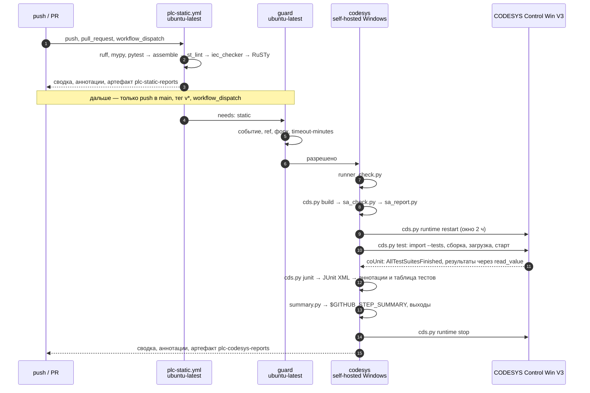
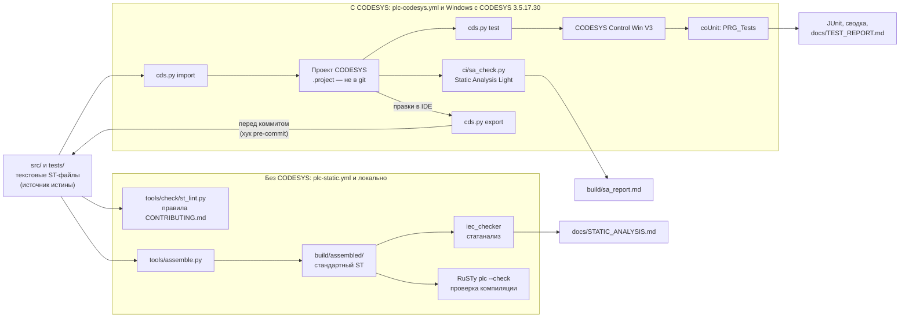

# Архитектура plc-ci-toolkit

plc-ci-toolkit — обёртка для CI вокруг инструментов шаблона plc-repo-template. Сами проверки
делают инструменты репозитория-потребителя (`tools/assemble.py`, `tools/check/`,
`tools/codesys/cds.py`); тулкит добавляет переиспользуемые workflow GitHub Actions, скрипты `ci/`
(сводка, проверка раннера, Static Analysis Light, хук pre-commit) и правила, когда и где что
запускается. Инструменты шаблона тулкит не меняет: они приходят в репозиторий вместе с шаблоном, а
сюда — как тестовый стенд вместе с примером ST в `src/` и `tests/`.

Источник истины в любом ПЛК-репозитории — текстовые файлы ST в `src/` и `tests/` (раскладка —
[LAYOUT.md](LAYOUT.md)). Проект CODESYS (`.project`) бинарный, в git его нет: он собирается из
текстов скриптом, а после правок в IDE экспортируется обратно.

## Компоненты

| Компонент | Где выполняется | Что делает |
|---|---|---|
| [`.github/workflows/plc-static.yml`](../.github/workflows/plc-static.yml) | GitHub-hosted Linux | `workflow_call`: ruff, mypy, pytest, `assemble`, `st_lint`, iec_checker, RuSTy; сводка и артефакт |
| [`.github/workflows/plc-codesys.yml`](../.github/workflows/plc-codesys.yml) | `guard` — GitHub-hosted Linux; `codesys` — self-hosted Windows с CODESYS | `workflow_call`: Static Analysis Light, `cds.py test`, JUnit, публикация, сводка, артефакт |
| `ci/summary.py` | оба workflow, шаг «Сводка» | читает отчёты `build/` и итоги шагов, пишет `$GITHUB_STEP_SUMMARY`, аннотации `file:line`, выходы `result` и счётчики |
| `ci/runner_check.py` | `plc-codesys.yml`, первый шаг на раннере | Python 3.11+, `tools/codesys` шаблона на месте, `.plc-ci-toolkit/` — в `.git/info/exclude` |
| `ci/sa_check.py` + `ci/codesys/sa_light.py` | `plc-codesys.yml`, шаг SA | включает правила Static Analysis Light на время сеанса CODESYS и генерирует код; находки — `build/sa.json` с файлом и строкой |
| `ci/sa_report.py` | `plc-codesys.yml`, шаг SA | сверяет находки с базовой линией `ci/sa_baseline.json` репозитория, политика `--fail-on new\|any\|never`; `build/sa_report.md`, `build/sa_report.json` |
| `ci/check_exported.py` | pre-commit в рабочей копии | коммит останавливается, если проект CODESYS сохранён в IDE после последнего `cds.py import/export` |
| [`examples/consumer-ci.yml`](../examples/consumer-ci.yml) | репозиторий-потребитель | вызывающий workflow: `static` на каждый push и PR, `codesys` — только push в `main`, теги, вручную |
| `.github/workflows/ci.yml`, `codesys.yml` | CI самого тулкита | actionlint, тесты `ci/` на Linux и Windows, самопроверка обоих workflow на примере ST |

Все скрипты `ci/` — только стандартная библиотека Python 3.11+: на раннере не нужно ничего
устанавливать, кроме Python.

## Пайплайн репозитория-потребителя

### Linux: `plc-static.yml`

Шаги подготовки (выгрузка, Python, проверка входов, зависимости, загрузка iec_checker) идут по
порядку: при сбое любого из них проверки не запускаются. Сами проверки выполняются все, даже если
одна упала (`if: !cancelled() && <подготовка прошла>`), — сводка показывает полную картину, а не
первую ошибку. Необязательные проверки (`fail-on-rusty: false`, `fail-on-iec-checker: false`)
помечены `continue-on-error` и на итог не влияют. Бинарники инструментов закреплены: iec_checker
v0.4 — по размеру и SHA-256, образ nightly — по дайджесту, RuSTy v1.0.6 — по SHA-256 файлов релиза.

RuSTy загружается после pytest: с переменной `RUSTY_PLC` в окружении интеграционные тесты RuSTy
шли бы внутри pytest, и необязательная проверка стала бы обязательной (ASSUMPTIONS.md, W9).

### Windows: `plc-codesys.yml`

| № | Шаг | Условие | Пишет |
|---|---|---|---|
| — | `guard` (отдельное задание, GitHub-hosted) | всегда | отказ, если событие не `push`/`workflow_dispatch`/`schedule`, ref не из `allowed-refs`, репозиторий — форк, `timeout-minutes` ≥ 110 |
| 1 | выгрузка репозитория и plc-ci-toolkit (`.plc-ci-toolkit/`) | — | рабочий каталог (очищается `actions/checkout`) |
| 2 | проверка раннера (`ci/runner_check.py`) | — | выход `version` |
| 3 | Static Analysis Light: `cds.py build`, `ci/sa_check.py`, `ci/sa_report.py` | `sa-check` | `build/sa.json`, `build/sa_report.md`, `build/sa_report.json` |
| 4 | `cds.py runtime restart` | `restart-runtime` | — |
| 5 | `cds.py test --clean` | шаг 2 прошёл | `build/test-results.json`, `build/junit.xml`, `build/build.json`, `build/test.log` |
| 6 | `cds.py junit` | шаг 5 запускался | `build/junit.xml` |
| 7 | публикация JUnit (`mikepenz/action-junit-report`, `annotate_only`) | `junit-report`, шаг 6 прошёл | аннотации упавших тестов, таблица в сводке |
| 8 | сводка (`ci/summary.py codesys`) | шаг 2 прошёл | `$GITHUB_STEP_SUMMARY`, аннотации ошибок компилятора, выходы задания |
| 9 | `cds.py runtime stop` | `always()`, `stop-runtime` | — |
| 10 | артефакт: `build/*.log`, `*.json`, `*.xml`, `*.md`, `build/codesys/*.log`, `*.json` | `!cancelled()` | артефакт `plc-codesys-reports` (14 дней) |

Почему такой порядок:

- **Статанализ до тестов.** `cds.py build` статанализа собирает рабочий проект (`src/`) и
  перезаписал бы `build/build.json` тестового проекта, а сводка показывает сборку именно с `tests/`.
  Перезапуск рантайма ближе к тестам оставляет им больше времени демо-режима. Тесты запускаются и
  тогда, когда статанализ не прошёл (ASSUMPTIONS.md, W7).
- **Анализ — генерацией кода, а не разбором сборки.** `cds.py build` вызывает `app.rebuild()`, а
  правила Static Analysis Light выполняются только при генерации кода; поэтому — отдельный сеанс
  CODESYS с `app.generate_code()` (S3, [sa_light.md](sa_light.md)).
- **Результаты coUnit — из переменных рантайма.** Файл xUnit coUnit 1.2.0.0 пишет в
  `VirtualStore` и неверно считает пропущенные тесты; `cds.py` читает счётчики и подробности
  через `read_value` (S1, [cfunit_results.md](cfunit_results.md)).
- **Итог — в сводке, а не в коде выхода сводки.** Шаг сводки завершается с кодом 0 и передаёт итог
  выходом `result`; задание падает на самом шаге, который не прошёл (`cds.py test`, SA), и в
  журнале запуска видно, какой именно.
- **Рантайм один на машину.** Задания одного репозитория идут по очереди (`concurrency` с
  `queue: max`, без отмены ожидающих; у вызывающего workflow в примере общая группа — только для
  pull request), задания разных репозиториев разводит глобальная блокировка
  `cds.py` (`%LOCALAPPDATA%\plc-tools\codesys-runtime.lock`): `runtime restart`/`stop` ждут, пока
  рантаймом пользуется чужое задание.

Скрипты шагов — Windows PowerShell 5.1 (есть на любой Windows) со своей строкой `shell`:
`-ExecutionPolicy Bypass` только для процесса и `-File "{0}"` вместо `-Command ". '{0}'"` встроенной
оболочки — так код выхода `cds.py` (3, 4, 5) доходит до журнала шага, а не сводится к 1. Только
ASCII: раннер пишет файл скрипта в UTF-8 без BOM, а PowerShell 5.1 читает его в кодировке ANSI
(W6). Сообщения по-русски выводят скрипты Python.

### Откуда берутся скрипты `ci/`

Переиспользуемый workflow выполняется в контексте вызывающего репозитория: в его checkout нет
`ci/summary.py`. Поэтому второй `actions/checkout` выгружает plc-ci-toolkit в `.plc-ci-toolkit/` с
`repository: job.workflow_repository` и `ref: job.workflow_sha` — тот же коммит, что и сам
workflow. Вызов по тегу `@v1` даёт согласованные workflow и скрипты без отдельного входа с версией.
Входы `toolkit-repository`/`toolkit-ref` — запасной путь (GitHub Enterprise Server, отладка).

### Отчёты: кто пишет, кто читает

| Файл в `build/` | Пишет | Читает |
|---|---|---|
| `pytest.xml` | pytest (`--junit-xml`) | `summary.py static` |
| `st_lint.json` | `st_lint.py --json` | `summary.py static`: аннотации |
| `iec_checker.json`, `iec_checker.md` | `run_iec_checker.py` | `summary.py static`: необоснованные находки — аннотации |
| `rusty.json`, `rusty.log` | `run_rusty.py` | `summary.py static` |
| `sa.json`, `sa.log` | `ci/sa_check.py` | `ci/sa_report.py` |
| `sa_report.md`, `sa_report.json` | `ci/sa_report.py` | `summary.py codesys --extra-md` |
| `build.json`, `build.log` | `cds.py build` / `cds.py test` | `summary.py codesys`: ошибки компилятора — аннотации по `src/` |
| `test-results.json`, `test.log` | `cds.py test` | `cds.py junit`, `summary.py codesys` |
| `junit.xml` | `cds.py test`, `cds.py junit` | `mikepenz/action-junit-report` |
| `codesys/state.json` | `cds.py import/export` | `ci/check_exported.py` (pre-commit) |

## Два контура проверок

| Контур | Где работает | Что ловит | Чего не ловит |
|---|---|---|---|
| Без CODESYS | GitHub-hosted Linux и любой ПК с Python 3.11+ | нарушения раскладки и правил именования, «магические числа», синтаксис и типы (RuSTy), находки статанализа (iec_checker) | особенности компилятора CODESYS, поведение в рантайме |
| С CODESYS | self-hosted Windows с CODESYS 3.5.17.30 (переменные `CODESYS_EXE`, `CODESYS_PROFILE`) | ошибки компиляции CODESYS, находки Static Analysis Light, результаты тестов coUnit в Control Win V3 | правила платной версии Static Analysis |

Собранный текст в `build/assembled/` нужен только анализаторам: в CODESYS он не импортируется.
Варианты сборки (`iec`, `rusty`, `iec-checker`) описаны в [LAYOUT.md](LAYOUT.md#собранный-текст-buildassembled).

## Каталоги

| Каталог | Содержимое |
|---|---|
| `.github/workflows/` | переиспользуемые `plc-static.yml`, `plc-codesys.yml`; CI тулкита `ci.yml`, `codesys.yml` |
| `ci/` | скрипты CI (стандартная библиотека Python 3.11+), правила `sa_rules.json`, базовая линия `sa_baseline.json`, тесты `ci/tests/` |
| `examples/` | `consumer-ci.yml` — вызывающий workflow; `consumer/.pre-commit-config.yaml`; `st/` — обёртка `GVL_TestResults` |
| `src/` | пример приложения шаблона: DUT, GVL, интерфейс, POU с методами и свойствами — тестовый стенд workflow |
| `tests/` | наборы тестов coUnit 1.2.0.0 (пространство имён `coUnit`) и `PRG_Tests`; при импорте — в папку проекта `Tests` |
| `tools/` | инструменты шаблона (не меняются здесь): `assemble.py`, `check/`, `codesys/` (`cds.py`, скрипты CODESYS Scripting, `config.json`) |
| `docs/` | документация, отчёты, медиа README (`docs/media/`) |
| `build/` | артефакты сборки и проверок, в git не хранится |

## Пример в src/

Минимальный, но законченный пример показывает все виды объектов раскладки. Объект вымышленный:
насос подкачки, который поддерживает уровень в баке.

| Объект | Вид | Роль |
|---|---|---|
| `E_DeviceMode` | перечисление | режимы устройства: `Auto`, `Manual`, `Local`, `OutOfService` |
| `ST_ExampleCmd`, `ST_ExampleSts` | структуры | обмен с HMI/SCADA: команды и состояние |
| `GVL_Const` | GVL, константы | диапазоны уставки и гистерезиса, предел счётчика |
| `I_Resettable` | интерфейс | метод `Reset` — сброс любого объекта одним кодом |
| `F_Clamp` | функция | ограничение значения отрезком; семантика — в [ASSUMPTIONS.md](ASSUMPTIONS.md#семантика-f_clamp) |
| `FB_Example` | ФБ, `IMPLEMENTS I_Resettable` | двухпозиционный регулятор с гистерезисом; методы `Reset`, `Acknowledge`, свойство `Count` (только чтение) |
| `PRG_Main` | программа | однократные команды HMI, вызов `FB_Example`, состояние для HMI |
| `FB_F_Clamp_Test`, `FB_Example_Test`, `PRG_Tests` | тесты (`tests/`) | наборы тестов CfUnit для `F_Clamp` (границы, порядок границ) и `FB_Example` (пороги, гистерезис, отказ и квитирование, режимы, счётчик, сброс) и программа запуска |

### Поведение FB_Example

| Режим | Выход `xOut` |
|---|---|
| `Auto` | включается при `rValue_pct <= уставка - гистерезис`, отключается при `rValue_pct >= уставка`, в зоне между ними сохраняет состояние. При недостоверном измерении (`xValueValid = FALSE`) фиксируется отказ `xFault` и выход отключается до квитирования |
| `Manual` | повторяет команду оператора `xManualOn` |
| `Local` | `FALSE`: устройством управляют с местного поста, команда ПЛК снимается |
| `OutOfService` и любое другое значение | `FALSE` — безопасное состояние |

- Уставка и гистерезис ограничиваются диапазонами из `GVL_Const` через `F_Clamp`.
- `Acknowledge()` снимает отказ, только если измерение снова достоверно.
- `Reset()` отключает выход, сбрасывает отказ и счётчик включений.
- `Count` — число включений выхода (передний фронт) с последнего `Reset()`; на пределе UDINT
  счётчик не переполняется.
- Пример не использует время. В реальных устройствах выдержки делаются таймерами (`TON`) или по
  источнику времени, а не счётом циклов (правило из `CONTRIBUTING.md`).

### Чего в примере нет (сознательно)

Диагностики по NAMUR NE 107, проверки 4–20 мА по NAMUR NE 43, минимального времени работы и паузы
насоса. Это задачи библиотеки устройств следующих проектов портфолио; шаблон показывает только
каркас и инструменты.
