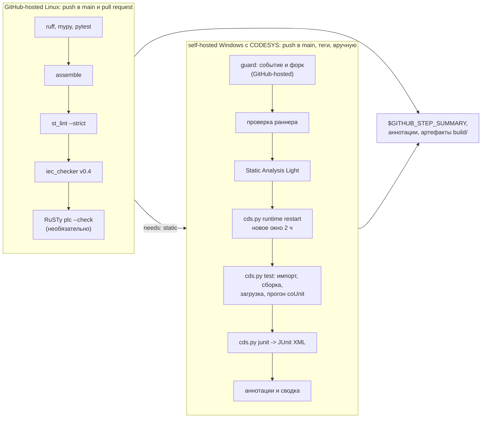

# Подключение plc-ci-toolkit к своему репозиторию

plc-ci-toolkit даёт два переиспользуемых workflow GitHub Actions для ПЛК-репозиториев на шаблоне
[plc-repo-template](https://github.com/kr0nsch/plc-repo-template):

| Workflow | Где выполняется | Что делает |
|---|---|---|
| [`plc-static.yml`](../.github/workflows/plc-static.yml) | GitHub-hosted Linux (`ubuntu-latest`) | ruff, ruff format, mypy, pytest для `tools/`; сборка ST (`assemble`); линтер `st_lint --strict`; статанализ iec_checker; проверка RuSTy (необязательно) |
| [`plc-codesys.yml`](../.github/workflows/plc-codesys.yml) | self-hosted Windows с CODESYS 3.5.17.30 (метки `self-hosted`, `windows`, `codesys`) | Static Analysis Light; импорт `src/` и `tests/` в проект CODESYS, сборка, загрузка в CODESYS Control Win V3, прогон тестов coUnit (CfUnit), JUnit XML, публикация результатов |



Сводка каждого задания — на странице запуска (Summary): таблица проверок, находки с файлом и
строкой, тесты coUnit. Те же находки — аннотациями в диффе коммита и pull request. Полные отчёты —
артефакты `plc-static-reports` и `plc-codesys-reports` (каталог `build/`, хранятся 14 дней).

## 1. За 10 минут: проверки без CODESYS

Нужно: репозиторий на шаблоне plc-repo-template (`tools/`, `src/`, `tests/`, `pyproject.toml`,
`requirements-dev.txt`), Python 3.11+ и git локально. CODESYS не нужен.

1. **Проверьте, что инструменты шаблона на месте** (из корня своего репозитория):

   ```bash
   ls tools/assemble.py tools/check/st_lint.py tools/codesys/cds.py requirements-dev.txt pyproject.toml
   ```

2. **Прогоните локально то же, что проверит CI** — так первый запуск не станет красным из-за
   замечаний, которые видно и без GitHub:

   ```bash
   python -m pip install -r requirements-dev.txt
   python -m ruff check . && python -m ruff format --check . && python -m mypy && python -m pytest -q
   python tools/assemble.py --tests
   python tools/check/st_lint.py --strict
   ```

3. **Добавьте вызывающий workflow** — копию [examples/consumer-ci.yml](../examples/consumer-ci.yml):

   ```bash
   mkdir -p .github/workflows
   curl -fsSL https://raw.githubusercontent.com/kr0nsch/plc-ci-toolkit/v1/examples/consumer-ci.yml \
     -o .github/workflows/plc-ci.yml
   ```

   В PowerShell — `Invoke-WebRequest <тот же URL> -OutFile .github/workflows/plc-ci.yml`; можно и
   просто скопировать файл из этого репозитория.

4. **Проверьте ссылки `uses:`** — обе указывают на `kr0nsch/plc-ci-toolkit` и тег `@v1`:

   ```bash
   grep -n "uses:" .github/workflows/plc-ci.yml
   ```

   Ожидается `uses: kr0nsch/plc-ci-toolkit/.github/workflows/plc-static.yml@v1` и такая же
   строка для `plc-codesys.yml`. Для своего форка plc-ci-toolkit замените владельца:
   `sed -i 's#kr0nsch/plc-ci-toolkit#имя-владельца/plc-ci-toolkit#g' .github/workflows/plc-ci.yml`.

5. **Уберите CI шаблона.** В репозитории из шаблона уже есть `.github/workflows/ci.yml` с теми же
   проверками (ruff, pytest, `st_lint`, iec_checker, RuSTy): задание `static` его заменяет, а вместе
   они гоняли бы проверки дважды. Удалите его и поменяйте бейдж CI в README на `plc-ci.yml`
   (раздел 7):

   ```bash
   git rm .github/workflows/ci.yml
   grep -n "workflows/ci.yml" README.md
   ```

   Оставить `ci.yml` можно, если в нём есть свои задания, — тогда уберите из него дублирующиеся.

6. **Отправьте в ветку и откройте pull request:**

   ```bash
   git switch -c ci/plc-ci-toolkit
   git add .github/workflows/plc-ci.yml
   git commit -m "ci: проверки plc-ci-toolkit"
   git push -u origin ci/plc-ci-toolkit
   ```

   В pull request запустится задание «Проверки без CODESYS» (несколько минут). Задание
   «CODESYS — сборка и тесты coUnit» для pull request не запускается никогда — это намеренно
   (раздел 3).

7. **Настройки репозитория** (Settings → Actions → General), один раз:
   - «Workflow permissions» — **Read repository contents and packages permissions**: workflow
     plc-ci-toolkit хватает чтения;
   - «Approval for running fork pull request workflows from contributors» — **Require approval for
     all external contributors**;
   - если включён список разрешённых actions — добавить `mikepenz/action-junit-report@*`
     (остальные — `actions/*` от GitHub); если ваш репозиторий принадлежит не владельцу
     plc-ci-toolkit, — ещё `kr0nsch/plc-ci-toolkit/.github/workflows/plc-static.yml@*` и
     `kr0nsch/plc-ci-toolkit/.github/workflows/plc-codesys.yml@*` (переиспользуемые workflow
     проверяются тем же списком).

8. **Бейдж в README** — раздел 7.

После слияния PR проверки идут на каждый push в `main`. Для части с CODESYS нужен раннер — раздел 2.

## 2. CODESYS на self-hosted раннере

Один раз на машину (около часа, в основном установка CODESYS):

1. Машина, учётная запись, программы и первая проверка `cds.py test` под учётной записью раннера —
   [runner_setup.md](runner_setup.md), разделы 1–5.
2. Регистрация раннера с меткой `codesys` для своего репозитория и первый ручной запуск —
   [MANUAL_STEPS.md](MANUAL_STEPS.md#9-self-hosted-раннер-порядок-действий), разделы 9–13.
3. Переменная репозитория **`PLC_CODESYS_RUNNER` = `true`** (Settings → Secrets and variables →
   Actions → Variables). Без неё вызывающий workflow задание CODESYS пропускает — иначе без раннера
   оно ждало бы в очереди до 24 часов и завершалось ошибкой.
4. Ручной запуск: Actions → **PLC CI** → **Run workflow** → `main` (или `gh workflow run plc-ci.yml --ref main`).

Секреты GitHub заданию не нужны: путь к CODESYS и учётные данные тестового пользователя рантайма —
на машине раннера ([runner_setup.md, раздел 5](runner_setup.md#5-переменные-окружения)).

## 3. Политика запуска

| Событие | `static` (Linux) | `codesys` (self-hosted Windows) |
|---|---|---|
| `push` в `main` | да | да |
| `push` тега `v*` | да | да |
| `workflow_dispatch` (вручную) | да | да |
| `schedule` (если добавите в `on:`) | да | да, если добавить `schedule` и в условие `if:` задания |
| `pull_request`, в том числе из форка | да | **нет** |
| `pull_request_target`, `workflow_run`, `issue_comment` | не используются | **нет** |
| любое событие в форке репозитория | да | **нет** |

Ручной запуск (`workflow_dispatch`) разрешён с любой ветки: так можно прогнать ветку в CODESYS до
слияния. Запустить его может только тот, у кого есть право записи в репозиторий (он и так может
отправить код в `main`). Ограничить ветки ручных запусков могло бы окружение с правилом веток
([runner_security.md, раздел 3.3](runner_security.md#33-окружение-с-обязательным-одобрением)), но
задание `codesys` окружение пока не объявляет ([ASSUMPTIONS.md](ASSUMPTIONS.md#ci-и-раннер-plc-ci-toolkit), E6).

Две защиты от ошибки конфигурации:

1. условие `if:` у задания `codesys` в вызывающем workflow ([examples/consumer-ci.yml](../examples/consumer-ci.yml));
2. задание `guard` внутри `plc-codesys.yml`: на GitHub-hosted раннере, до задания на машине с
   CODESYS, оно завершает запуск ошибкой, если событие не `push`, `workflow_dispatch` или
   `schedule`, если репозиторий — форк, если push не в ссылку из входа `allowed-refs`, если
   `timeout-minutes` 110 и больше.

От pull request, который сам меняет workflow, YAML не защищает: автор PR уберёт любые условия. От
этого защищает одобрение запусков из форков (шаг 7 раздела 1) — подробно в
[runner_security.md](runner_security.md#31-политика-запуска).

## 4. `plc-static.yml`: входы и выходы

| Вход | Тип | По умолчанию | Смысл |
|---|---|---|---|
| `python-version` | string | `"3.12"` | Python на раннере (инструментам шаблона нужен 3.11+) |
| `python-checks` | boolean | `true` | ruff check, ruff format --check, mypy, pytest по `pyproject.toml` репозитория |
| `requirements` | string | `requirements-dev.txt` | файл зависимостей Python-проверок |
| `paths` | string | `src tests` | каталоги раскладки ST через пробел: первый — исходники, второй — тесты; `st_lint` проверяет все |
| `iec-checker` | string | `binary` | `binary` — iec_checker v0.4 из релиза (закреплён по размеру и SHA-256), `docker` — образ `nightly` по дайджесту, `off` |
| `fail-on-iec-checker` | boolean | `true` | необоснованные находки iec_checker валят задание |
| `rusty` | boolean | `true` | проверка RuSTy `plc --check` (v1.0.6, SHA-256) |
| `fail-on-rusty` | boolean | `false` | ошибки RuSTy валят задание; по умолчанию проверка только информирует |
| `working-directory` | string | `.` | корень ПЛК-репозитория внутри checkout (монорепозиторий) |
| `artifact-name` | string | `plc-static-reports` | имя артефакта с `build/`; при нескольких вызовах — разные |
| `timeout-minutes` | number | `20` | таймаут задания |
| `toolkit-repository`, `toolkit-ref` | string | пусто | откуда брать скрипты `ci/` (см. раздел 6); обычно не задаются |

| Выход | Значение |
|---|---|
| `result` | `success` или `failure` — итог обязательных проверок (пусто — задание не дошло до сводки) |
| `st-lint-errors` | число ошибок `st_lint` |
| `iec-checker-errors` | число необоснованных находок iec_checker |
| `rusty-errors` | число ошибок RuSTy |

Пример — RuSTy обязателен, iec_checker в образе nightly без блокировки:

```yaml
  static:
    uses: kr0nsch/plc-ci-toolkit/.github/workflows/plc-static.yml@v1
    with:
      iec-checker: docker
      fail-on-iec-checker: false
      fail-on-rusty: true
```

Обоснования находок iec_checker — `tools/check/iec_checker_allow.toml` репозитория (подобраны под
v0.4, поэтому по умолчанию — `binary`), исключения RuSTy — `tools/check/rusty_exclude.txt`.

## 5. `plc-codesys.yml`: входы и выходы

| Вход | Тип | По умолчанию | Смысл |
|---|---|---|---|
| `runner-labels` | string | `["self-hosted", "windows", "codesys"]` | метки раннера, JSON-массив |
| `python` | string | `python` | команда или полный путь Python 3.11+ на раннере (без аргументов) |
| `restart-runtime` | boolean | `true` | `cds.py runtime restart` перед тестами — новое окно демо-режима 2 ч |
| `stop-runtime` | boolean | `true` | `cds.py runtime stop` в конце задания (и после отмены): в простое порты рантайма закрыты |
| `allowed-refs` | string | `refs/heads/main refs/tags/*` | ссылки, для которых разрешён запуск по push (маски через пробел) |
| `junit-report` | boolean | `true` | публикация `build/junit.xml`: аннотации упавших тестов и таблица в сводке |
| `sa-check` | boolean | `true` | Static Analysis Light: `cds.py build`, `ci/sa_check.py`, `ci/sa_report.py` ([sa_light.md](sa_light.md)) |
| `sa-fail-on` | string | `new` | политика `ci/sa_report.py`: `new` — находки вне базовой линии `ci/sa_baseline.json` репозитория валят задание, `any` — любые, `never` — только отчёт |
| `working-directory` | string | `.` | корень ПЛК-репозитория внутри checkout |
| `artifact-name` | string | `plc-codesys-reports` | имя артефакта с журналами и отчётами; при нескольких вызовах в одном запуске — разные |
| `timeout-minutes` | number | `90` | таймаут задания на раннере; меньше 110 (демо-режим рантайма — 2 ч), иначе `guard` откажет |
| `toolkit-repository`, `toolkit-ref` | string | пусто | откуда брать скрипты `ci/` (раздел 6) |

| Выход | Значение |
|---|---|
| `result` | `success` или `failure` |
| `tests`, `passed`, `failed`, `skipped` | счётчики тестов coUnit |
| `build-errors`, `build-warnings` | ошибки и предупреждения компилятора CODESYS (тестовый проект) |

Порядок шагов на раннере: проверка раннера (`ci/runner_check.py`: Python 3.11+, `tools/codesys`
шаблона) → Static Analysis Light → `cds.py runtime restart` → `cds.py test --clean` →
`cds.py junit` → публикация JUnit → сводка (`ci/summary.py`) → `cds.py runtime stop` → артефакты
(`build/*.log`, `build/*.json`, `build/*.xml`, `build/*.md`, `build/codesys/*.log|json`; проекты
`.project` и кэш CODESYS в артефакт не попадают). Статанализ идёт до тестов: тесты запускаются и
тогда, когда он не прошёл, а `build/build.json` в сводке — от сборки тестового проекта.

Задания репозитория на раннере идут по очереди (`concurrency` с `queue: max`, ожидающие задания не
отменяются); задания разных репозиториев на одной машине разводит блокировка рантайма `cds.py`.
Собственная `concurrency` вызывающего workflow с общей группой для push в `main` отменяла бы
ожидающий запуск целиком (по умолчанию в группе ждёт только один) — поэтому в
[examples/consumer-ci.yml](../examples/consumer-ci.yml) общая группа только у pull request, а у
push и ручного запуска группа своя (`github.run_id`).

Если шаг на раннере упал, код выхода `cds.py` или скрипта `ci/` виден в конце журнала шага
(«Process completed with exit code N»): скрипт шага запускается через `powershell -File`, который
передаёт код как есть (0 — успех, 1 — проверка не прошла, 3 — окружение, 4 — таймаут, 5 —
блокировка занята).

## 6. Версии и закрепление

- Вызывайте workflow по тегу основной версии: `...@v1`. Тег `v1` двигается на последний выпуск
  `v1.x.y` без несовместимых изменений входов. Строже — по полному SHA коммита plc-ci-toolkit
  (`...@<40 символов>`): тогда обновления только явные.
- Скрипты `ci/` (сводка, проверка раннера, Static Analysis Light) workflow берёт из **того же
  коммита**, что и себя: `actions/checkout` с `repository: job.workflow_repository` и
  `ref: job.workflow_sha` (контекст `job`, [справочник контекстов GitHub](https://docs.github.com/en/actions/reference/workflows-and-actions/contexts)).
  Выгрузка — в `.plc-ci-toolkit/` рабочего каталога; она добавляется в `.git/info/exclude` и не
  проверяется ruff. Входы `toolkit-repository` и `toolkit-ref` нужны только для отладки другой
  версии скриптов (например, своего форка plc-ci-toolkit). GitHub Enterprise Server не
  поддерживается: там нет этих свойств контекста `job`, а `actions/upload-artifact` v4 и новее на
  GHES не работает.
- Все actions внутри workflow закреплены по полному SHA коммита (версии и источники —
  [ASSUMPTIONS.md](ASSUMPTIONS.md#переиспользуемые-workflow-plc-ci-toolkit), W1).
- Права токена: `contents: read` у заданий, `permissions: {}` у `guard`. Вызывающему workflow
  достаточно `permissions: contents: read`. Секреты workflow не объявляют и не используют:
  `secrets: inherit` в вызове не нужен — не передавайте секреты на self-hosted раннер без нужды.

## 7. Бейджи

В README своего репозитория (подставьте владельца и имя репозитория; `plc-ci.yml` — имя
вызывающего workflow):

```markdown
[](https://github.com/<владелец>/<репозиторий>/actions/workflows/plc-ci.yml)
```

Бейдж показывает итог последнего запуска workflow в `main` — обоих заданий вместе. Нужны
отдельные бейджи для проверок без CODESYS и для CODESYS — разделите вызывающий workflow на два
файла (например, `plc-static.yml` с `on: [push, pull_request]` и `plc-codesys.yml` с
`on: push` в `main`, тегами и `workflow_dispatch`) и поставьте бейдж на каждый. Пока раннер не
подключён, задание CODESYS пропускается; что при этом показывает бейдж, _не проверено_ — не
выдавайте его за прогон в CODESYS, подтверждённые прогоны записываются в `docs/TEST_REPORT.md`.

Статичные бейджи [shields.io](https://shields.io/badges/static-badge) для README — например:

```markdown


```

## 8. Если не работает

| Признак | Что делать |
|---|---|
| `static`: «нет файла requirements-dev.txt» | файл другой — вход `requirements`; Python-проверки не нужны — `python-checks: false` |
| `static`: iec_checker — ParserError | конструкция, которую не разбирает iec_checker v0.4 ([tools/README.md](../tools/README.md#понижение-для-iec_checker---flavor-iec-checker)); переписать или `iec-checker: off` |
| `static`: «в выгрузке plc-ci-toolkit нет ci/summary.py», `codesys`: «No ci/runner_check.py in the plc-ci-toolkit checkout» | выгрузилась не та версия скриптов (например, `toolkit-ref` указывает на старый коммит): задайте `toolkit-repository: kr0nsch/plc-ci-toolkit` и `toolkit-ref: v1` или уберите эти входы |
| `codesys` не запускается | нет переменной `PLC_CODESYS_RUNNER=true`, событие не из таблицы раздела 3 или запуск не из `main` |
| `guard`: «событие … запрещено» | вызывающий workflow вызывает `plc-codesys.yml` для pull request — исправить условие `if:` по примеру |
| остальное на раннере | [MANUAL_STEPS.md, раздел 14](MANUAL_STEPS.md#14-если-windows-job-не-прошёл) |
